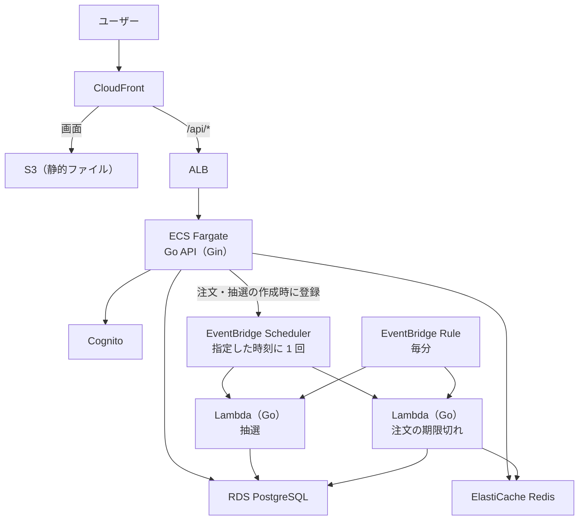

# FlashBuy

日本語 | [中文](README_zh.md)

数量限定の商品を「抽選」と「先着順」で販売する EC サイトです。バックエンドは Go（Gin、sqlx、go-redis）で作り、画面は React、実行環境は AWS です。

特に力を入れたのは次の 3 点です。

- **アクセスが集中しても、在庫以上に売れないこと**（Redis と DB の 3 段階チェック、[3](#3-オーバーセル対策)）
- **Go の API を、失敗したときまで考えて作ること**（トランザクション、戻し処理、タイムアウト、終了処理、冪等性、[4](#4-go-の実装)）
- **一人でも運用できること**（Terraform、GitHub Actions、自動ロールバック、監視、[7](#7-インフラ)）

| | |
|---|---|
| デモ | <https://d3vk1w3oavfogf.cloudfront.net>（ログイン画面のボタンで、一般ユーザー / 管理者としてログインできます） |
| 期間 | 2026年8月〜10月（約11週間）、個人開発 |
| 決済 | モックです。サーバー側で 40% の確率で失敗を返します |

> 費用を抑えるため、使わない期間は API などを停止しています（[7.4](#74-費用)）。画面は表示されますが、データが出ない場合は停止中です。

---

## 目次

1. [構成](#1-構成)
2. [主な処理](#2-主な処理)
3. [オーバーセル対策](#3-オーバーセル対策)
4. [Go の実装](#4-go-の実装)
5. [テスト](#5-テスト)
6. [負荷試験](#6-負荷試験)
7. [インフラ](#7-インフラ)
8. [CI/CD](#8-cicd)
9. [トラブル事例](#9-トラブル事例)
10. [既知の課題](#10-既知の課題)
11. [ローカルでの実行](#11-ローカルでの実行)

---

## 1. 構成



| 分類 | 技術 |
|---|---|
| バックエンド | Go 1.26 / Gin / sqlx / go-redis / zap / viper |
| DB・キャッシュ | PostgreSQL 15、Redis 7.1 |
| フロントエンド | React 19 / TypeScript / Vite / Tailwind CSS |
| 認証 | Cognito（JWT を API 側で検証） |
| 実行環境 | ECS Fargate（ARM64）、Lambda（Go、ARM64） |
| 非同期処理 | EventBridge Scheduler / Rule |
| IaC / CI/CD | Terraform、GitHub Actions（OIDC） |
| 監視 | CloudWatch、SNS |

### ディレクトリ

```text
api/
  cmd/server/     起動と終了の処理
  config/         設定の読み込み（YAML + 環境変数）
  router/         ルーティング
  middleware/     JWT の検証、権限の確認
  controllers/    API ごとの処理
  models/         テーブルに対応する構造体
  pkg/            DB、Redis、Cognito、Scheduler、S3、ログ、レスポンスなどの共通処理
lambdas/
  order_expirer/  注文の期限切れ
  lottery_drawer/ 抽選（当選者を選ぶ処理は draw/ に分けている）
terraform/        インフラ（9 ディレクトリ）
frontend/         画面
```

### 主な API

| メソッド | パス | 認証 | 内容 |
|---|---|---|---|
| GET | `/api/v1/flash/list`、`/api/v1/lottery/list` | なし | 商品の一覧 |
| POST | `/api/v1/flash/buy` | 必要 | 先着順で購入 |
| POST | `/api/v1/lottery/apply` | 必要 | 抽選に応募 |
| POST | `/api/v1/payment/mock` | 必要 | 支払い（モック） |
| GET | `/api/v1/my/flashOrderList` など | 必要 | 自分の注文 |
| POST | `/api/v1/admin/flash`、`/api/v1/admin/lottery` | 管理者 | 商品・抽選の作成 |
| POST | `/api/v1/admin/cache/flush` | 管理者 | Redis のキャッシュを消して DB から作り直す |

---

## 2. 主な処理

### 先着順販売

1. JWT と販売期間を確認する
2. Redis で在庫を 1 減らす。在庫がなければ「売り切れ」を返す
3. トランザクションで注文を作り（未払い、支払期限は 15 分後）、DB の在庫も 1 減らす
4. 支払期限の時刻に、Scheduler の一回限りのスケジュールを登録する
5. 注文番号を返す

### 抽選

1. ユーザーが応募する（1 人 1 回、ユニーク制約で保証）
2. 管理者が抽選を作ると、抽選時刻のスケジュールを登録する
3. 抽選時刻に Lambda が応募者から当選者を選ぶ
4. 当選者は 72 時間以内に支払う。期限を過ぎた注文はキャンセルされる

### 2 つの呼び出し方

Lambda は、次の 2 つの方法で呼ばれます。

| | Scheduler | EventBridge Rule |
|---|---|---|
| タイミング | 登録した時刻に 1 回 | 毎分 |
| 対象 | 1 件の注文・抽選 | 期限を過ぎて残っているもの全部 |
| 役割 | 時間どおりに処理する | 取りこぼしを拾う |

Scheduler の登録が失敗しても、毎分のスキャンで処理されます。同じ対象が両方から処理されても結果が変わらないように作っています（[4.4](#44-冪等性と行ロック)）。

---

## 3. オーバーセル対策

すべての購入リクエストが DB の同じ行を更新すると、行ロックの待ちが長くなります。そのため、在庫の判定は先に Redis で行い、DB は最終的な記録として使っています。

在庫は 3 か所でチェックしています。

1. **Redis**：Lua スクリプトで「在庫の確認」と「1 減らす」をまとめて実行します。Redis はスクリプトの実行中にほかのコマンドを処理しないので、同時にリクエストが来ても在庫より多くは減りません
2. **DB**：`UPDATE ... SET stock = stock - 1 WHERE stock > 0` を実行し、更新件数が 0 ならロールバックします
3. **CHECK 制約**：テーブルに `CHECK (0 <= stock <= total_stock)` を付けています

```lua
local stock = redis.call('GET', KEYS[1])
if not stock then return -2 end            -- まだ読み込んでいない
if tonumber(stock) <= 0 then return -1 end  -- 売り切れ
return redis.call('DECR', KEYS[1])
```

Go 側では、戻り値の `-1` / `-2` を `ErrOutOfStock` / `ErrNotPreheated` という error に変えて返します。`ErrNotPreheated` のときは、DB の在庫を `SETNX` で書き込んでから、もう一度減らします。`SETNX` なので、同時に読み込みが走っても、先に減らした数を上書きしません。

同じユーザーが同じ商品を二重に買うことは、部分ユニークインデックス（未払い・支払済みの注文の `user_id, flash_id`）で防いでいます。

Redis の在庫には期限（TTL）を付けていません。キャッシュではなく、販売中の正しい数として扱っているためです。Redis が使えないとき、商品の表示は DB から読みますが、購入はエラーを返します。

---

## 4. Go の実装

### 4.1 エラーとレスポンス

API は、すべて同じ形の JSON を返します。

```json
{ "code": 10001, "message": "商品はすでに売り切れです" }
```

| code | 意味 |
|---|---|
| 0 | 成功 |
| 400 / 401 / 403 | パラメータ不正 / 認証エラー / 権限なし |
| 500 | システムエラー |
| 10001 | 売り切れ |
| 10002 | 抽選に応募済み |
| 10003 | 支払期限切れ |
| 10004 | 購入済み |

- 業務エラーも HTTP 200 で返し、`code` で判断します。CloudFront は 403 / 404 を `index.html` に置き換える設定なので、API が 404 を返すと HTML が返り、画面側の JSON の解析が壊れるためです。そのかわり、ログのエラー件数を監視しています（[7.3](#73-監視)）
- エラーの判定は `errors.Is` / `errors.As` で行います。たとえば、`sql.ErrNoRows` はパラメータ不正、PostgreSQL のユニーク制約違反（`23505`）は「購入済み」に変えます
- Lambda では `fmt.Errorf("...: %w", err)` で情報を付けて返し、呼び出し元で原因をたどれるようにしています

### 4.2 トランザクションと失敗時の戻し

購入では、Redis で在庫を減らしたあとに DB のトランザクションを開きます。Redis と DB は同じトランザクションに入れられないので、**DB 側のどこで失敗しても、Redis の在庫を 1 戻します**。

| 失敗する場所 | 対応 |
|---|---|
| トランザクションの開始 | Redis を戻して、システムエラー |
| 注文の INSERT（二重購入） | ロールバック、Redis を戻して「購入済み」 |
| 在庫の UPDATE（更新件数 0） | ロールバック、Redis を戻して「売り切れ」 |
| コミット | Redis を戻して、システムエラー |
| スケジュールの登録 | 注文は成立しているので、ログだけ残す（毎分のスキャンで拾う） |

Lambda のキャンセル処理は、`BeginTxx(ctx, nil)` のすぐあとに `defer tx.Rollback()` を書いています。途中で `return` してもロールバックされ、コミットしたあとは何もしません。Redis の在庫はコミットのあとで戻します。もし失敗しても、キーを消せば次のアクセスで DB の値から作り直されます。

### 4.3 タイムアウトと終了処理

- **Redis**：すべての操作に `context.WithTimeout`（2 秒）を付けています。Redis が応答しなくても、リクエストが止まらないようにするためです
- **HTTP サーバー**：`ReadHeaderTimeout`・`ReadTimeout`・`WriteTimeout`・`IdleTimeout` を付けています。省略すると無制限になり、何も送らない接続にソケットを取られ続けます。ALB のアイドルタイムアウト（60 秒）より先に切れる値にしています
- **終了処理**：サーバーは goroutine で起動し、`SIGTERM` を channel で待ちます。受け取ったら `srv.Shutdown` を呼び、処理中のリクエストを最大 5 秒待ってから止めます。ECS のタスクを入れ替えるときに、リクエストが途中で切れないようにするためです
- **外部 API**：Lambda から SNS を呼ぶときは 3 秒のタイムアウトを付けています（[9.2](#92-lambda-から-sns-への送信に-51-秒かかった)）

### 4.4 冪等性と行ロック

Lambda は同じ対象に 2 回呼ばれることがあるので、何回実行しても結果が変わらないようにしています。

- **キャンセル**：`UPDATE ... WHERE status = 'UNPAID' AND expires_at < now() RETURNING ...` で、取り消せた行だけを返します。2 回目は対象がないので、在庫も二重に戻りません
- **毎分のスキャン**：`FOR UPDATE SKIP LOCKED` を使い、個別のキャンセルと同じ行で待たないようにしています
- **抽選**：抽選の行を `FOR UPDATE` でロックしてから、`status = 'WAITING'` の応募だけを更新します。同時に 2 回動いても、2 回目は何もしません
- **応募**：`INSERT ... ON CONFLICT (user_id, lottery_id) DO NOTHING` で、二重応募を 1 回の SQL で弾きます
- **支払い**：`UPDATE ... WHERE status = 'UNPAID' AND expires_at >= now()` にして、期限切れの処理が走る前でも、期限を過ぎた注文は払えないようにしています

### 4.5 キャッシュ

一覧や詳細は、Generics で作った `cache.Remember[T]` で、キャッシュになければ DB から読んで書き戻します（Cache Aside）。

```go
flashList, err := cache.Remember(cache.KeyFlashList, cache.TTLList,
    func() ([]models.FlashItem, error) { /* DB から取得 */ })
```

- 一覧の TTL は 30 秒です。詳細は `RememberUntil` で、販売終了の時刻までを TTL にしています
- Redis が使えないときは、エラーにせず DB から読みます。キャッシュは速くするためのもので、止まっても表示はできるようにしています
- 管理者のロールは JWT に入っていないので DB から読み、5 分間キャッシュします
- Redis と DB の在庫がずれたときは、管理者 API でアプリのキーを消して作り直します。`KEYS` は Redis を止めてしまうので、`SCAN` で少しずつ消しています

### 4.6 接続と goroutine

- **接続プール**：API の DB 接続は最大 50 です（理由は [6](#6-負荷試験)）
- **Lambda**：`sync.Once` で接続を 1 回だけ作り、次の呼び出しでも使い回します。Lambda 1 つあたりの接続は 1 本（`SetMaxOpenConns(1)`）です
- **goroutine の使い分け**：期限切れの処理は、ローカル環境では API の中の goroutine で 1 分ごとに動かします。ECS でタスクを増やすと goroutine も増えて二重に処理されるため、AWS 上では Lambda に任せています

### 4.7 認証

- Cognito の JWT を、API のミドルウェアで公開鍵を使って検証します。確認するのは、署名（RS256 のみ）、`iss`、`exp`、`aud`、`token_use` です
- 公開鍵（JWKS）は起動時に取得し、1 時間ごとに取り直します。知らない鍵 ID が来たときも取り直します
- 管理者の API は、`AuthRequired()` のあとに `RequireRole("admin")` をつないで守っています

### 4.8 設定とログ

- 設定は viper で、`config-{環境}.yaml` を読み、`FLASHBUY_` で始まる環境変数で上書きします。本番の値はイメージに入れず、ECS のタスク定義から環境変数で渡します
- ログは zap です。本番は JSON で出力し、CloudWatch でそのまま検索や集計ができます

### 4.9 抽選のアルゴリズム

当選者は、Fisher-Yates シャッフルで選びます。乱数は予測できないように `crypto/rand` を使います。この処理は DB や AWS に依存しない関数（`draw.PickWinners`）に分けているので、単体でテストできます。

---

## 5. テスト

| 対象 | 件数 | 内容 |
|---|---|---|
| 購入 API | 3 | 在庫なし、二重購入、DB の在庫切れのときに Redis を戻すこと |
| 注文の期限切れ | 13 | キャンセルの SQL の条件、Redis の在庫の戻し、期限切れの流れ全体 など |
| 抽選 | 4 | 当選人数、重複や漏れがないこと、入力を書き換えないこと、偏り |

購入 API のテストは、DB を `sqlmock`、Redis を `miniredis` に置き換えているので、コンテナを使わずに動きます。どのテストも、PR のたびに GitHub Actions で実行されます。

---

## 6. 負荷試験

k6 で、動いている環境の購入 API に一定のレートでリクエストを送りました。

- 構成：ECS タスク 1 つ（0.25 vCPU / 512 MB）、RDS db.t4g.micro、Redis 1 ノード
- 1 回 15〜30 秒、在庫 100,000

| 目標 | 実際の処理量 | p95 | 結果 |
|---|---|---|---|
| 50 req/s | 49.9 req/s | 49 ms | エラーなし |
| 120 req/s | 118.5 req/s | 56 ms | エラーなし |
| 150 req/s | 138.9 req/s | 1.17 s | 処理はできるが遅くなる |
| 200 req/s | 84.7 req/s | 5.45 s | 処理しきれず、473 件を送れなかった |

毎秒 120 リクエストまでは安定しています。RDS の CPU は 10% 未満で、ボトルネックは ECS の CPU（0.25 vCPU）です。200 req/s でも 5xx は出ていません。

**接続プール**：最初はプールの上限を 100 にしていて、150 req/s で 500 エラーが 239 件出ました。RDS の `max_connections` は 79 で、予約分を除くと約 65 しか使えないためです。上限を 50 に下げると、エラーは 0 になり、処理量も 112.3 → 138.9 req/s に上がりました。残りの接続は Lambda 用です。

**オーバーセル**：在庫 200 に対して 15 秒で 1,501 リクエストを送り、注文は 200 件、残りの 1,301 件は「売り切れ」（`10001`）でした。

数字はこの構成でのものです。タスク数やインスタンスを変えた場合は、測り直す必要があります。

---

## 7. インフラ

リージョンは `ap-northeast-1` です。ECS Fargate を選んだのは、サーバーの管理が要らず、常に動いているプロセスで DB や Redis の接続を使い回せるからです。期限切れ処理と抽選は、決まった時刻に数秒で終わる処理なので Lambda にしました。

### 7.1 ネットワーク

- VPC は 2 AZ で、パブリックサブネットとプライベートサブネットが 2 つずつ
- ALB はパブリック。CloudFront（マネージドプレフィックスリスト）からの通信だけを許可
- ECS はパブリックサブネットに置き、パブリック IP を付けています。NAT を置いていないため、Scheduler や Cognito の API を呼ぶにはこの形が必要です。受け付けるのは ALB からの通信だけです
- RDS、Redis、Lambda はプライベートサブネット
- NAT Gateway と VPC エンドポイントは、費用の理由で置いていません（影響は [10](#10-既知の課題)）

### 7.2 権限

- DB のパスワードは Secrets Manager に置き、ECS タスクの起動時に環境変数として渡します
- GitHub Actions は OIDC で一時的な認証情報を取得します。IAM ロールは用途ごとに 5 つに分けていて、API のデプロイ用ロールは ECR への push と ECS の更新しかできません

### 7.3 監視

- CloudWatch のアラームは 14 個です（ALB、ECS、RDS、Redis、Lambda、アプリのエラーログ）。通知は SNS からメールで届きます
- 業務エラーは HTTP 200 で返すので、ALB の 5xx では検知できません。ログの `level=error` をメトリクスにして、5 分間に 5 件以上でアラームを出しています
- RDS の接続数は 60 でアラームを出します。実際に使えるのが約 65 なので、その前に気づけるようにしています

### 7.4 費用

すべて動かすと月 約76ドルです。`scripts/spindown.sh` で ALB、ECS、RDS、Redis、Lambda などを削除すると、月 約1ドルになります。`scripts/spinup.sh` で依存関係の順に作り直し、DB の初期データを入れて、API が応答するところまで確認します。

Cognito は削除しません。作り直すとユーザーの ID（`sub`）が変わり、初期データと合わなくなるためです。

### 7.5 Terraform

`terraform/` は 9 つのディレクトリに分け、state もそれぞれ別にしています（S3、`use_lockfile` でロック）。よく変える `compute`・`lambda` と、ほとんど変えない `data` などを分けて、1 回の apply で影響する範囲を小さくしています。

apply は手元で手動実行しています。PR では、フォーマットのチェックと plan が自動で走るので、差分はそこで確認します。

---

## 8. CI/CD

| workflow | 内容 |
|---|---|
| `api-ci` / `lambda-ci` | `develop`・`main` への push と PR で、ビルドとテスト |
| `api-cd` | `v*` タグで ARM64 のイメージを作り、ECR に push、ECS をローリング更新 |
| `lambda-cd` | `v*` タグでコードを更新し、新しいバージョンを発行して、エイリアス `live` を切り替え |
| `frontend` | `develop` は開発環境、`main` は本番（承認が必要） |
| `terraform` | PR でフォーマットのチェックと plan |
| `ci-notify` | CI が失敗したら GitHub Issue を作る |

- Docker イメージはマルチステージビルドです。`CGO_ENABLED=0` で ARM64 向けにクロスコンパイルし、Go のバイナリだけを Alpine に入れています
- タグは `main` に含まれるコミットにしか付けられないようにしています
- ECS はサーキットブレーカーで、起動に失敗したら自動で前のバージョンに戻ります。ロールバックされた場合もサービスは安定状態になるので、最後に動いているタスク定義を確認して、成功か失敗かを判定しています
- 手動で戻すときは、ECS は前のタスク定義、Lambda は前のバージョンにエイリアスを向けます。どちらもコマンド 1 回です

---

## 9. トラブル事例

### 9.1 期限切れの注文が、すぐにキャンセルされなかった

- **現象**：期限が過ぎても在庫が戻らず、毎分のスキャンまで待つことがあった
- **原因**：DB に書く期限と、スケジュールに登録する時刻で、それぞれ `time.Now()` を呼んでいた。スケジュールが数ミリ秒早く実行され、「まだ期限前」と判断されていた
- **対応**：期限の時刻は 1 回だけ計算し、DB とスケジュールで同じ値を使うようにした

### 9.2 Lambda から SNS への送信に 51 秒かかった

- **現象**：抽選後の SNS への送信がなかなか終わらなかった
- **原因**：NAT も VPC エンドポイントもないため、プライベートサブネットの Lambda から SNS に届かず、SDK が再試行を続けていた
- **対応**：外部への呼び出しには `context.WithTimeout`（SNS は 3 秒）を付けた。DB パスワードは Secrets Manager から取れないため、Lambda には環境変数で渡すようにした

### 9.3 抽選のスケジュールが登録されていないのに、エラーにならなかった

- **現象**：抽選の作成は成功するのに、Scheduler にスケジュールがなかった
- **原因**：IAM ポリシーのリソースに schedule group の ARN を書いていた。正しくはその下の `schedule/<group>/*`。API は登録の失敗をログに出すだけで、成功を返していた
- **対応**：ARN を直した。登録が失敗しても処理が漏れないように、毎分のスキャンも残した

---

## 10. 既知の課題

| 課題 | 内容 | 対応案 |
|---|---|---|
| DB への context | API の DB 操作は `context` を受け取っていないため、リクエストが切れても SQL は最後まで実行される | `QueryRowContext` などに変え、リクエストの `context` を渡す |
| 抽選結果の通知 | Lambda から SNS に届かないので、当選者に通知が送れない。この失敗は Lambda のエラーにならないため、アラームも鳴らない | SNS の VPC エンドポイントを追加（月 約14ドル） |
| パスワードの渡し方 | Lambda には DB パスワードを環境変数で渡している | Secrets Manager のエンドポイントを追加して戻す |
| 可用性 | ECS 1 タスク、RDS シングル AZ、Redis 1 ノード。`/ping` はプロセスの生存しか見ていない | タスクを 2 つにし、DB と Redis も確認するヘルスチェックを追加 |
| 環境 | 本番の画面も、開発環境の API を使っている | 本番用のバックエンドを分ける |
| 抽選の繰り上げ | 当選者が支払わなかった枠は、次の人に回らない | 抽選時に順位を記録し、キャンセル時に次の人に回す |

---

## 11. ローカルでの実行

```bash
cd api && docker compose up -d                 # PostgreSQL 15 + Redis 7
PGPASSWORD=postgres psql -h localhost -U postgres -d flashbuy -f init_db.sql
APP_ENV=local go run ./cmd/server              # API :8080
go test ./...                                  # テスト
cd ../frontend && pnpm install && pnpm dev     # 画面 :5173
```

`APP_ENV` を指定しないとクラウド用の設定（`dev`）になるので、ローカルでは `APP_ENV=local` を付けます。認証は Cognito を使うため、AWS の認証情報が必要です。

---

## 開発について

コードの実装には生成 AI（Claude Code）を使っています。設計、AWS の構築、レビュー、動作確認、トラブルの調査と対応は自分で行いました。

## License

[MIT License](LICENSE)
