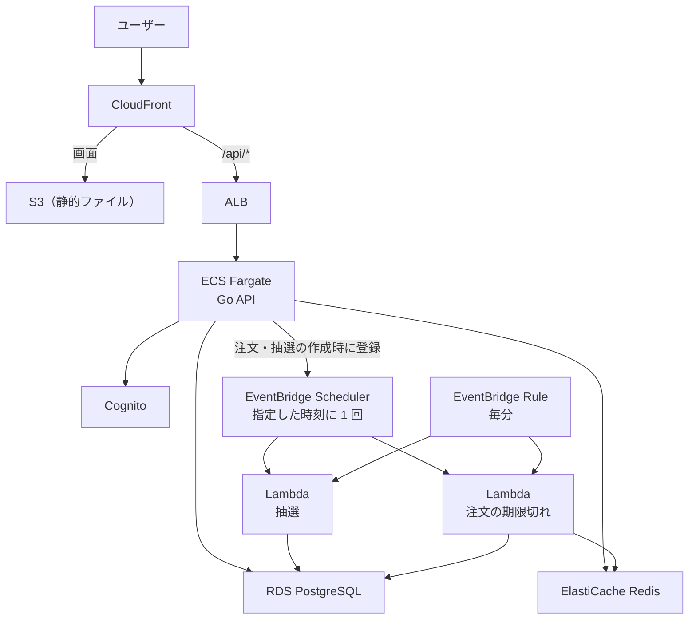

# FlashBuy

日本語 | [中文](README_zh.md)

数量限定の商品を「抽選」と「先着順」で販売する EC サイトです。API は Go、画面は React で作り、AWS 上で動かしています。インフラは Terraform、デプロイは GitHub Actions で管理しています。

特に力を入れたのは次の 2 点です。

- アクセスが集中しても、在庫以上に売れない（オーバーセルしない）こと
- 一人でも運用できるインフラにすること（自動デプロイ、自動ロールバック、監視、費用の管理）

| | |
|---|---|
| デモ | <https://d3vk1w3oavfogf.cloudfront.net>（ログイン画面のボタンで、一般ユーザー / 管理者としてログインできます） |
| 期間 | 2026年8月〜10月（約11週間）、個人開発 |
| 決済 | モックです。サーバー側で 40% の確率で失敗を返します |

> 費用を抑えるため、使わない期間は API などを停止しています（[5.4](#54-費用)）。画面は表示されますが、データが出ない場合は停止中です。

---

## 目次

1. [構成](#1-構成)
2. [主な処理](#2-主な処理)
3. [オーバーセル対策](#3-オーバーセル対策)
4. [負荷試験](#4-負荷試験)
5. [インフラ](#5-インフラ)
6. [IaC と CI/CD](#6-iac-と-cicd)
7. [トラブル事例](#7-トラブル事例)
8. [既知の課題](#8-既知の課題)
9. [テスト](#9-テスト)
10. [ローカルでの実行](#10-ローカルでの実行)

---

## 1. 構成



| 分類 | 技術 |
|---|---|
| フロントエンド | React 19 / TypeScript / Vite / Tailwind CSS |
| バックエンド | Go 1.26 / Gin / sqlx / go-redis |
| DB・キャッシュ | RDS PostgreSQL 15、ElastiCache Redis 7.1 |
| 認証 | Cognito |
| 実行環境 | ECS Fargate（ARM64）、Lambda（Go、ARM64） |
| 非同期処理 | EventBridge Scheduler / Rule |
| 配信 | S3 + CloudFront |
| IaC / CI/CD | Terraform、GitHub Actions（OIDC） |
| 監視 | CloudWatch、SNS |

ECS Fargate を選んだのは、サーバーの管理が要らず、常に動いているプロセスで DB や Redis の接続を使い回せるからです。期限切れ処理と抽選は、決まった時刻に数秒で終わる処理なので Lambda にしました。

---

## 2. 主な処理

### 先着順販売

1. JWT と販売期間を確認する
2. Redis で在庫を 1 減らす。在庫がなければ「売り切れ」を返す
3. トランザクションで注文を作り（未払い、支払期限は 15 分後）、DB の在庫も 1 減らす
4. 支払期限の時刻に、Scheduler の一回限りのスケジュールを登録する
5. 注文番号を返す

### 抽選

1. 管理者が抽選を作ると、抽選時刻のスケジュールを登録する
2. 抽選時刻に Lambda が応募者から当選者を選ぶ（`crypto/rand` でシャッフル）
3. 当選者は 72 時間以内に支払う。期限を過ぎた注文はキャンセルされる

### 2 つの呼び出し方

Lambda は、次の 2 つの方法で呼ばれます。

| | Scheduler | EventBridge Rule |
|---|---|---|
| タイミング | 登録した時刻に 1 回 | 毎分 |
| 対象 | 1 件の注文・抽選 | 期限を過ぎて残っているもの全部 |
| 役割 | 時間どおりに処理する | 取りこぼしを拾う |

Scheduler の登録が失敗しても、毎分のスキャンで処理されます。同じ対象が両方から処理されても結果は変わりません。キャンセルの SQL は「未払い」かつ「期限切れ」の注文だけを更新し、抽選は対象の行をロック（`FOR UPDATE`）してから処理するためです。

---

## 3. オーバーセル対策

すべての購入リクエストが DB の同じ行を更新すると、行ロックの待ちが長くなります。そのため、在庫の判定は先に Redis で行い、DB は最終的な記録として使っています。

在庫は 3 か所でチェックしています。

1. **Redis**：Lua スクリプトで「在庫の確認」と「1 減らす」をまとめて実行します。Redis はスクリプトの実行中にほかのコマンドを処理しないので、同時にリクエストが来ても在庫より多くは減りません
2. **DB**：`UPDATE ... SET stock = stock - 1 WHERE stock > 0` を実行し、更新件数が 0 ならロールバックします
3. **CHECK 制約**：テーブルに `CHECK (0 <= stock <= total_stock)` を付けています

DB の処理が失敗したときは、Redis の在庫を 1 戻します。同じユーザーが同じ商品を二重に買うことは、部分ユニークインデックス（未払い・支払済みの注文の `user_id, flash_id`）で防いでいます。

Redis の在庫は、最初のアクセスで DB から読み込みます。期限（TTL）は付けていません。Redis が使えないとき、商品の表示は DB から読みますが、購入はエラーを返します。

---

## 4. 負荷試験

k6 で、動いている環境の購入 API に一定のレートでリクエストを送りました。

- 構成：ECS タスク 1 つ（0.25 vCPU / 512 MB）、RDS db.t4g.micro、Redis 1 ノード
- 1 回 15〜30 秒、在庫 100,000

| 目標 | 実際の処理量 | p95 | 結果 |
|---|---|---|---|
| 50 req/s | 49.9 req/s | 49 ms | エラーなし |
| 120 req/s | 118.5 req/s | 56 ms | エラーなし |
| 150 req/s | 138.9 req/s | 1.17 s | 処理はできるが遅くなる |
| 200 req/s | 84.7 req/s | 5.45 s | 処理しきれず、473 件を送れなかった |

毎秒 120 リクエストまでは安定しています。RDS の CPU は 10% 未満で、ボトルネックは ECS の CPU（0.25 vCPU）です。200 req/s でも 5xx は出ていません。

**接続プール**：最初はプールの上限を 100 にしていて、150 req/s で 500 エラーが 239 件出ました。RDS の `max_connections` は 79 で、予約分を除くと約 65 しか使えないためです。上限を 50 に下げると、エラーは 0 になり、処理量も 112.3 → 138.9 req/s に上がりました。残りの接続は Lambda 用です。

**オーバーセル**：在庫 200 に対して 15 秒で 1,501 リクエストを送り、注文は 200 件、残りの 1,301 件は「売り切れ」（`10001`）でした。

数字はこの構成でのものです。タスク数やインスタンスを変えた場合は、測り直す必要があります。

---

## 5. インフラ

リージョンは `ap-northeast-1` です。

### 5.1 ネットワーク

- VPC は 2 AZ で、パブリックサブネットとプライベートサブネットが 2 つずつ
- ALB はパブリック。セキュリティグループで、CloudFront（マネージドプレフィックスリスト）からの通信だけを許可
- ECS はパブリックサブネットに置き、パブリック IP を付けています。NAT を置いていないため、Scheduler や Cognito の API を呼ぶにはこの形が必要です。受け付けるのは ALB からの通信だけです
- RDS、Redis、Lambda はプライベートサブネット
- NAT Gateway と VPC エンドポイントは、費用の理由で置いていません（影響は [8](#8-既知の課題)）

### 5.2 認証と権限

- Cognito の JWT を、API 側で公開鍵を使って検証します（署名、`iss`、`exp`、`token_use`、`aud`）
- DB のパスワードは Secrets Manager に置き、ECS タスクの起動時に環境変数として渡します
- GitHub Actions は OIDC で一時的な認証情報を取得します。IAM ロールは用途ごとに 5 つに分けていて、API のデプロイ用ロールは ECR への push と ECS の更新しかできません

### 5.3 監視

- CloudWatch のアラームは 14 個です（ALB、ECS、RDS、Redis、Lambda、アプリのエラーログ）。通知は SNS からメールで届きます
- API の業務エラーは HTTP 200 で返すので、ALB の 5xx では検知できません。ログの `level=error` をメトリクスにして、5 分間に 5 件以上でアラームを出しています
- RDS の接続数は 60 でアラームを出します。実際に使えるのが約 65 なので、その前に気づけるようにしています
- Redis の Evictions などは、ダッシュボードで確認しています

### 5.4 費用

すべて動かすと月 約76ドルです。`scripts/spindown.sh` で ALB、ECS、RDS、Redis、Lambda などを削除すると、月 約1ドルになります。`scripts/spinup.sh` で依存関係の順に作り直し、DB の初期データを入れて、API が応答するところまで確認します。

Cognito は削除しません。作り直すとユーザーの ID（`sub`）が変わり、初期データと合わなくなるためです。

---

## 6. IaC と CI/CD

### 6.1 Terraform

`terraform/` は 9 つのディレクトリに分け、state もそれぞれ別にしています（S3、`use_lockfile` でロック）。よく変える `compute`・`lambda` と、ほとんど変えない `data` などを分けて、1 回の apply で影響する範囲を小さくしています。

apply は手元で手動実行しています。PR では、フォーマットのチェックと 8 ディレクトリの plan が自動で走るので、差分はそこで確認します。

### 6.2 GitHub Actions

| workflow | 内容 |
|---|---|
| `api-ci` / `lambda-ci` | `develop`・`main` への push と PR で、ビルドとテスト |
| `api-cd` | `v*` タグで ARM64 のイメージを作り、ECR に push、ECS をローリング更新 |
| `lambda-cd` | `v*` タグでコードを更新し、新しいバージョンを発行して、エイリアス `live` を切り替え |
| `frontend` | `develop` は開発環境、`main` は本番（承認が必要）。S3 に置き、CloudFront の `index.html` のキャッシュを消す |
| `terraform` | PR でフォーマットのチェックと plan |
| `ci-notify` | CI が失敗したら GitHub Issue を作る |

- タグは `main` に含まれるコミットにしか付けられないようにしています
- ECS はサーキットブレーカーで、起動に失敗したら自動で前のバージョンに戻ります。ロールバックされた場合もサービスは安定状態になるので、最後に動いているタスク定義を確認して、成功か失敗かを判定しています
- 手動で戻すときは、ECS は前のタスク定義、Lambda は前のバージョンにエイリアスを向けます。どちらもコマンド 1 回です

---

## 7. トラブル事例

### 7.1 抽選のスケジュールが登録されていないのに、エラーにならなかった

- **現象**：抽選の作成は成功するのに、Scheduler にスケジュールがなかった
- **原因**：IAM ポリシーのリソースに schedule group の ARN を書いていた。正しくはその下の `schedule/<group>/*`。API は登録の失敗をログに出すだけで、成功を返していた
- **対応**：ARN を直した。登録が失敗しても処理が漏れないように、毎分のスキャンも残した

### 7.2 Lambda から SNS への送信に 51 秒かかった

- **現象**：抽選後の SNS への送信がなかなか終わらなかった
- **原因**：NAT も VPC エンドポイントもないため、プライベートサブネットの Lambda から SNS に届かず、SDK が再試行を続けていた
- **対応**：外部への呼び出しにはタイムアウト（SNS は 3 秒）を付けた。DB パスワードは Secrets Manager から取れないため、Lambda には環境変数で渡すようにした

### 7.3 期限切れの注文が、すぐにキャンセルされなかった

- **現象**：期限が過ぎても在庫が戻らず、毎分のスキャンまで待つことがあった
- **原因**：DB に書く期限と、スケジュールに登録する時刻で、それぞれ現在時刻を取っていた。スケジュールが数ミリ秒早く実行され、「まだ期限前」と判断されていた
- **対応**：期限の時刻は 1 回だけ計算し、DB とスケジュールで同じ値を使うようにした

---

## 8. 既知の課題

| 課題 | 内容 | 対応案 |
|---|---|---|
| 抽選結果の通知 | Lambda から SNS に届かないので、当選者に通知が送れない。この失敗は Lambda のエラーにならないため、アラームも鳴らない | SNS の VPC エンドポイントを追加（月 約14ドル） |
| パスワードの渡し方 | Lambda には DB パスワードを環境変数で渡している | Secrets Manager のエンドポイントを追加して戻す |
| 可用性 | ECS 1 タスク、RDS シングル AZ、Redis 1 ノード。`/ping` はプロセスの生存しか見ていない | タスクを 2 つにし、DB と Redis も確認するヘルスチェックを追加 |
| 環境 | 本番の画面も、開発環境の API を使っている | 本番用のバックエンドを分ける |
| 抽選の繰り上げ | 当選者が支払わなかった枠は、次の人に回らない | 抽選時に順位を記録し、キャンセル時に次の人に回す |

---

## 9. テスト

- 注文の期限切れ処理：13 件
- 抽選：4 件（当選人数、重複や漏れがないこと、入力を書き換えないこと、偏り）
- 購入 API：3 件（在庫なし、二重購入、DB の在庫切れ時に Redis を戻すこと）

購入 API のテストは、DB を `sqlmock`、Redis を `miniredis` に置き換えて、コンテナを使わずに実行しています。どのテストも CI で動きます。

---

## 10. ローカルでの実行

```bash
cd api && docker compose up -d                 # PostgreSQL 15 + Redis 7
PGPASSWORD=postgres psql -h localhost -U postgres -d flashbuy -f init_db.sql
APP_ENV=local go run ./cmd/server              # API :8080
cd ../frontend && pnpm install && pnpm dev     # 画面 :5173
```

`APP_ENV` を指定しないとクラウド用の設定（`dev`）になるので、ローカルでは `APP_ENV=local` を付けます。認証は Cognito を使うため、AWS の認証情報が必要です。

---

## 開発について

コードの実装には生成 AI を使っています。設計、AWS の構築、レビュー、動作確認、トラブルの調査と対応は自分で行いました。

## License

[MIT License](LICENSE)
