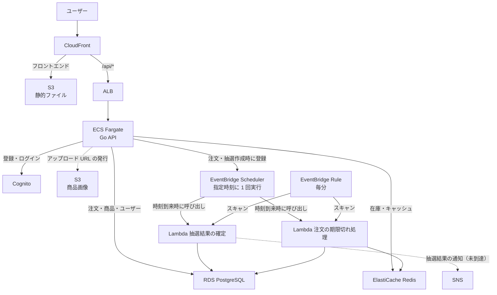
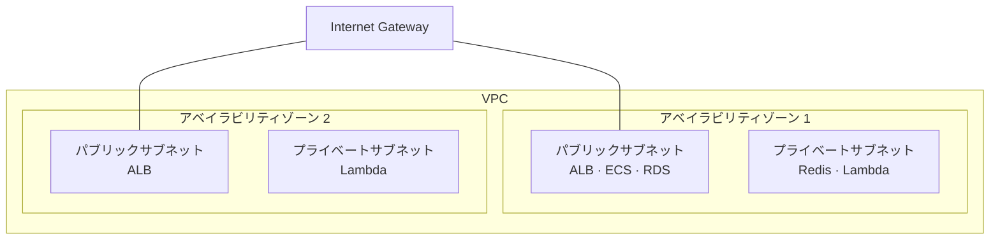
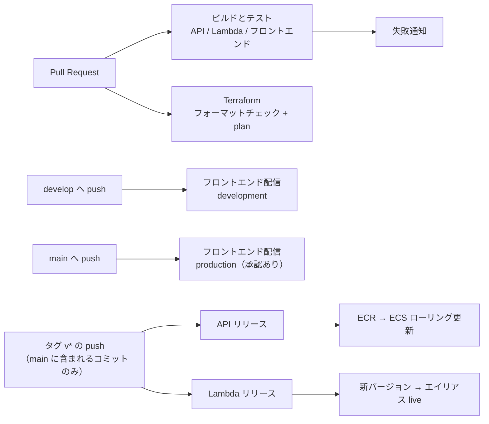
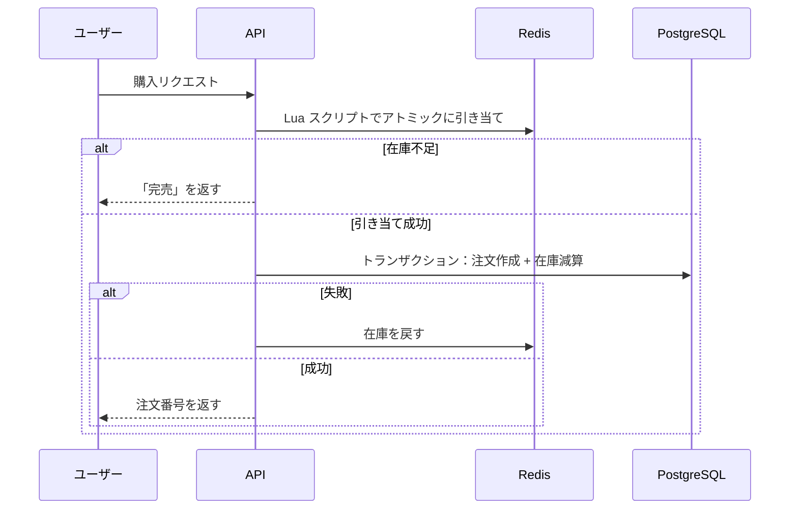

# FlashBuy

日本語 | [中文](README_zh.md)

FlashBuy は、数量限定のフラッシュセールと公平な抽選を提供する EC システムです。Go（Gin）+ PostgreSQL / React で実装し、AWS 上にデプロイしています。インフラと CI/CD は、それぞれ Terraform と GitHub Actions が担っています。決済はモックで、成功・失敗はサーバー側が確率で決めます。

デモサイト：<https://d3vk1w3oavfogf.cloudfront.net>

ログイン画面のボタンから、USER / ADMIN としてワンクリックでログインできます。管理者でログインすると抽選の作成まで試せます。

---

## 目次

1. [アーキテクチャと処理フロー](#1-アーキテクチャと処理フロー)
2. [AWS インフラストラクチャ](#2-aws-インフラストラクチャ)
3. [IaC と CI/CD](#3-iac-と-cicd)
4. [売り越し防止と公平な抽選](#4-売り越し防止と公平な抽選)
5. [トラブルシューティング事例](#5-トラブルシューティング事例)
6. [その他](#6-その他)
7. [License](#7-license)

---

## 1. アーキテクチャと処理フロー

### 1.1 全体構成



### 1.2 業務フロー

**フラッシュセール**

```
1. Cognito の JWT と販売期間を検証し、期間外なら即座に拒否する
2. Redis の Lua スクリプトでアトミックに在庫を引き当てる。在庫がなければ「完売」を返す
3. トランザクションで注文を作成（UNPAID、期限は現在時刻 + 15 分）し、データベースの在庫を減算する
4. Scheduler に期限時刻のワンタイムスケジュールを登録する
5. 注文番号を返す
```

注文は同期的に処理します。在庫の引き当てが Redis の単一スレッドによるアトミック性に依存しており、ユーザーにも即座に結果を返す必要があるためです。注文の期限切れキャンセルと在庫の戻しは、独立したバッチ処理として Lambda が担当します。

**抽選**

```
1. 管理者が抽選を作成すると、API が抽選時刻のワンタイムスケジュールを Scheduler に登録する
2. 抽選時刻に Lambda が応募者一覧を読み、当選者をランダムに選ぶ
3. 当選者は UNPAID となり 72 時間以内に支払う。それ以外は LOST となる
4. 期限を過ぎても未払いの注文は、注文の期限切れ処理 Lambda がキャンセルする
```

### 1.3 技術スタック

| 分類 | 技術 |
|---|---|
| フロントエンド | React 19 / TypeScript / Vite / Tailwind CSS |
| バックエンド | Go 1.26 / Gin / sqlx / zap / viper |
| データベース・キャッシュ | PostgreSQL 15（RDS）、Redis 7.1（ElastiCache） |
| 認証 | Amazon Cognito |
| コンピューティング | ECS Fargate（ARM64）、Lambda（Go、ARM64） |
| スケジューリング | EventBridge Scheduler / Rule |
| 静的ホスティング | S3 + CloudFront |
| IaC / CI/CD | Terraform、GitHub Actions（OIDC） |
| 監視 | CloudWatch、SNS |

---

## 2. AWS インフラストラクチャ

リージョン：`ap-northeast-1`

### 2.1 ネットワーク

VPC は 2 つのアベイラビリティゾーンにまたがり、パブリックサブネットとプライベートサブネットをそれぞれ 2 つずつ配置しています。



- ALB のセキュリティグループは CloudFront のマネージドプレフィックスリストからのみ許可しています。ECS は ALB からのトラフィックのみ受け付けます。RDS と Redis は VPC の CIDR からの接続を許可し、加えて管理者の IP アドレスをホワイトリストで許可しています。
- **NAT Gateway と VPC エンドポイントは配置していません。** 固定費を抑えるためです（NAT Gateway は東京リージョンで月額約 45 ドル）。この構成による設計上の影響は次のとおりです。
  - Lambda はプライベートサブネットに配置し、VPC 内の RDS と Redis にのみアクセスします。DB パスワードは環境変数で渡します
  - ECS は Scheduler、Cognito、S3 などの AWS API を呼び出す必要があるため、パブリックサブネットに配置しパブリック IP を割り当てています
  - RDS はパブリックアクセスを有効にし、セキュリティグループのホワイトリストで接続元を限定しています。ローカルから直接接続してデバッグするためです

### 2.2 エントリポイントとコンピューティング

- **CloudFront**：デフォルトパスは S3、`/api/*` は ALB へ転送します。API のパスはキャッシュを無効化しています。フロントエンド配信用の S3 バケットは非公開で、CloudFront からの読み取りのみ許可しています。
- **ECS Fargate**：ARM64、0.25 vCPU / 512 MB、タスクは常時 1 つ。アプリケーションはステートレスに設計しています。
- **ローリング更新**：最小ヘルス率 100%、最大 200% で、新旧タスクを並存させてサービスを停止させません。デプロイの circuit breaker を有効化し、新タスクの起動に失敗した場合は自動でロールバックします。
- **ECR**：直近 5 つのイメージタグを保持します。
- **Secrets Manager**：DB パスワードを保管し、コンテナ起動時に環境変数として注入します。

### 2.3 データと認証

- **RDS PostgreSQL 15**：`db.t4g.micro`、シングル AZ、ストレージ暗号化。負荷が予測可能で現状は低いため、RDS を採用しています。Aurora Serverless v2 は 0 ACU まで縮小できますが、このシステムは毎分データベースをスキャンして終日接続があるため、自動一時停止の条件を満たしません。
- **ElastiCache Redis 7.1**：シングルノード、プライベートサブネットに配置。在庫のリアルタイム判定とキャッシュを担います。
- **S3**：商品画像はブラウザから署名付き URL で直接アップロードします。API は署名付き URL を発行するだけです。
- **Cognito**：メールアドレスとパスワードでログインします。トークンの有効期限は access / id が 24 時間、refresh が 30 日です。API は Cognito の公開鍵を使ってローカルで JWT の署名を検証します。ユーザーのロールは `users` テーブルに保持し、Redis に 5 分間キャッシュします。

### 2.4 非同期処理：Lambda と EventBridge

Lambda 関数は 2 つあります。**注文の期限切れ処理**（支払期限を過ぎても未払いの注文をキャンセル）と、**抽選結果の確定**です。いずれも実行タイミングが明確で、1 回の実行は数秒で完了します。リアルタイム応答も不要なため、呼び出し課金の Lambda に向いています。

各関数には独立した 2 つのトリガーパスがあり、両方が同時に有効です。

| | パス 1：対象を指定して実行 | パス 2：毎分スキャン |
|---|---|---|
| トリガー | API が業務イベントの発生時に Scheduler へワンタイムスケジュールを登録し、時刻到来時に Scheduler が Lambda を呼び出す | EventBridge Rule が毎分 Lambda を呼び出す |
| 注文の期限切れ処理 | 注文成功時に「現在時刻 + 15 分」のスケジュールを登録し、期限までに未払いならキャンセルして在庫を戻す | 期限を過ぎた未払い注文（フラッシュセールと抽選の両方）をスキャンする |
| 抽選結果の確定 | 抽選の作成時に抽選時刻のスケジュールを登録し、時刻到来時に結果を確定する | 抽選時刻を過ぎても「応募中」の記録が残るものをスキャンする |

- 2 つのパスは同じ関数を呼び出し、イベントの `mode`（`cancel` / `draw` / `scan`）で処理を分岐します。`scan` は毎分スキャンからの呼び出しです。パス 1 は処理を遅延なく実行し、パス 2 は、パス 1 が取りこぼした分（スケジュール登録の失敗など）を回収します。
- ワンタイムスケジュールは注文や抽選ごとに実行時に作成する必要があるため、外部通信が可能な API が Scheduler を呼び出します。定期スキャンは固定のバッチ処理なので Terraform で静的に Rule として定義でき、Lambda 側に外部通信は不要です。

### 2.5 監視とアラート

CloudWatch はメトリクス、ログ、アラート、ダッシュボードをカバーし、各サービスと直接連携しているため、ネイティブ機能をそのまま採用しています。

**ダッシュボードの 8 ウィジェット**

| # | 種類 | 内容 |
|---|---|---|
| 1 | text | タイトル |
| 2 | metric | ALB リクエスト数と 5xx |
| 3 | metric | ALB 応答時間と異常ターゲット |
| 4 | metric | ECS タスクの CPU / メモリ |
| 5 | metric | RDS CPU / 接続数 |
| 6 | metric | Lambda 呼び出し回数とエラー |
| 7 | metric | ElastiCache CPU と Evictions |
| 8 | alarm | 12 個のアラーム状態 |

**12 個のアラーム**（SNS のメール購読へ通知）

| # | 名前 | メトリクス | しきい値 | 期間 × 回数 |
|---|---|---|---|---|
| 1 | `alb-unhealthy` | UnHealthyHostCount | 1 以上 | 60 秒 × 2 |
| 2 | `alb-5xx` | HTTPCode_Target_5XX_Count | 5 以上（5 分間の合計） | 300 秒 × 1 |
| 3 | `alb-latency` | TargetResponseTime | 2 秒超（5 分間の平均） | 300 秒 × 1 |
| 4 | `ecs-cpu` | CPUUtilization | 80% 超 | 300 秒 × 2 |
| 5 | `ecs-memory` | MemoryUtilization | 80% 超 | 300 秒 × 2 |
| 6 | `rds-cpu` | CPUUtilization | 80% 超 | 300 秒 × 2 |
| 7 | `rds-storage` | FreeStorageSpace | 2 GB 未満 | 300 秒 × 1 |
| 8 | `rds-connections` | DatabaseConnections | 60 超 | 300 秒 × 2 |
| 9 | `redis-cpu` | CPUUtilization | 80% 超 | 300 秒 × 2 |
| 10 | `lottery-drawer-errors` | Errors | 1 以上 | 300 秒 × 1 |
| 11 | `lottery-drawer-throttles` | Throttles | 1 以上 | 300 秒 × 1 |
| 12 | `order-expirer-errors` | Errors | 1 以上 | 300 秒 × 1 |

在庫データは Redis に保持しているため、Evictions（データの追い出し）もダッシュボードに表示しています。

### 2.6 コスト管理

用途に応じてクラウド環境を作成・削除する 2 つのスクリプトを用意しています。

- `scripts/spinup.sh`：依存関係の順に全リソースを作成し、ALB のヘルスチェックが通ることと、CloudFront 経由で API がデータを返すことを確認します。
- `scripts/spindown.sh`：課金対象のリソースを逆順に削除し、月額を約 76 ドルから約 1 ドルまで下げます。`frontend` / `auth` / `state` / `shared` / `storage` はデフォルトで残します。特に `auth` は必須です。Cognito を作り直すと `sub` が変わり、`init_db.sql` のシードユーザーと一致しなくなるためです。

停止中は画面を表示できますが API は利用できません（ALB は `compute` とともに削除されます）。`spinup.sh` を実行すると復旧します。

### 2.7 選定とトレードオフ

| 論点 | 採用 | 代替案 | 理由 |
|---|---|---|---|
| API の実行形態 | ECS Fargate | EC2 上での自前運用、API 全体を Lambda に載せる | ノード運用が不要。常駐プロセスは Redis のコネクションプールを再利用できるが、Lambda では接続の再利用とコールドスタートへの対応が必要になる |
| 在庫判定 | Redis でリアルタイム判定、PostgreSQL を永続記録とする | データベースの行ロックのみ | リクエストが集中すると行ロックで待ち行列が発生し、待ち時間が増幅する |
| 遅延実行 | Scheduler のワンタイムスケジュール | アプリケーション内のタイマー | 秒単位で指定でき、実行後に自動削除される。アプリ内タイマーは複数インスタンスで重複実行される |
| 認証 | Cognito | JWT の自前発行 | パスワードのハッシュ化、トークン発行、公開鍵のローテーションを自前で実装する必要がない |
| CI/CD | GitHub Actions + OIDC | CodePipeline | コードが既に GitHub 上にある。OIDC なら長期キーが不要 |

---

## 3. IaC と CI/CD

### 3.1 Terraform

9 つのモジュールに分割し、それぞれ独立した state を持ちます。`lambda` / `compute` / `frontend` は `terraform_remote_state` で上流の出力を参照し、`monitoring` はリソース名で検索します。

| モジュール | 内容 |
|---|---|
| `state` / `shared` | state 用の S3 バケット。GitHub OIDC Provider と CI 用の plan ロール |
| `data` | VPC、サブネット、RDS、ElastiCache、セキュリティグループ |
| `auth` / `storage` | Cognito。商品画像用の S3 バケット |
| `lambda` | Lambda、EventBridge、Scheduler ロール、SNS |
| `compute` | ALB、ECS、ECR、Secrets Manager |
| `frontend` | S3 + CloudFront（dev / prod） |
| `monitoring` | ダッシュボードとアラーム |

実行順序：`state` → `shared` → `data` → `auth` → `storage` → `lambda` → `compute` → `frontend` → `monitoring`

**分割の基準は変更頻度とデータのライフサイクルです。** `data` は作成に 8〜10 分かかり、主要なコスト要因でもありますが、あまり変更しません。`compute` / `lambda` はリリースごとに変わります。`auth` / `storage` はユーザーと画像データを保持し、ライフサイクルが独立しています。この分割により、変更した層だけを apply でき、環境を層ごとに破棄・再作成できます。トレードオフは、モジュールをまたぐ変更では順序に沿って複数回 apply する必要があることです。

### 3.2 CI/CD パイプライン

AWS の認証はすべて GitHub OIDC で取得した一時認証情報を使用しています。workflow は 7 本です。



| workflow | トリガー | 内容 |
|---|---|---|
| API CI / Lambda CI | push / PR | API は build / vet / test、Lambda は `build.sh` が `go test` を実行してから zip を生成する |
| API CD / Lambda CD | タグ `v*` の push | 1 つのタグで API と Lambda の両方がリリースされる。API のイメージタグにはタグ名をそのまま使う |
| Frontend | push / PR | lint / build の後、S3 へ配信し CloudFront のキャッシュを無効化する |
| Terraform CI | PR のみ | フォーマットチェックと、8 モジュールの並列 plan（`state` は初回 bootstrap 専用のため対象外。`apply` はローカルで手動実行） |
| CI Notify | 他の workflow 完了後 | 失敗時に Issue を作成し、復旧すると自動でクローズする。Slack 通知は必要に応じて有効化 |

### 3.3 リリースとロールバック

- **API リリース**：arm64 イメージをビルドして ECR へ push → 稼働中のタスク定義を取得し、イメージだけを差し替えて新しい revision を登録 → ECS サービスを更新して安定するまで待機 → 稼働中の revision と新しく登録した revision を比較します。デプロイ失敗で自動ロールバックした場合もサービスは stable になるため、比較結果で「デプロイ成功」と「失敗後のロールバック完了」を区別します。
- **Lambda リリース**：コードを更新して完了まで待機 → 新しいバージョンを発行 → `live` エイリアスを切り替えます。トリガーはすべてエイリアスを指しています。
- **ロールバック**：Lambda は `update-alias` で旧バージョンに、API は `update-service` で旧 revision に戻します。コマンドはどちらも 1 回で済みます。Lambda は即時に切り替わり、API は ECS のローリング更新が完了した時点で戻ります。
- **運用ルール**：チェック系のジョブは中断を許容し、リリース系のジョブは中断しません。リソース構造は Terraform、バージョンは CI が管理します（`ignore_changes`）。タグが指すコミットは main に含まれている必要があり、develop → main → タグの順序を強制します。

### 3.4 権限設計

- GitHub Actions は 5 つの IAM ロール（terraform-plan、api-dev、lambda-dev、frontend-dev、frontend-prod）を使い分け、用途ごとに権限をリソース範囲で絞っています。たとえば API リリース用のロールは ECR への push と ECS の更新など、リリースに必要な権限だけを持ち、インフラの変更は手動で行います。
- GitHub Environments のデプロイ制限：`development` は `develop` ブランチと `v*` タグ、`production` は `main` のみを許可し、人手による承認を要求します。
- Terraform plan のジョブは同一リポジトリの PR に限定しています。plan ロールは state バケット（DB パスワードを含む）を読めるため、公開リポジトリでは fork からの PR が PR 側の workflow 定義で実行され、認証情報を窃取される恐れがあります。

---

## 4. 売り越し防止と公平な抽選

### 4.1 売り越し防止

フラッシュセールでは短時間にリクエストが集中します。すべてのリクエストがデータベースの同じ行に対して `stock = stock - 1` を実行すると、行ロックで待ち行列が発生します。そこで在庫のリアルタイム判定は Redis に置き、データベースは最終的な記録として扱います。



1. **Redis によるアトミックな引き当て**：Lua スクリプトで「在庫の読み取り、充足判定、減算」を 1 回の呼び出しにまとめ、実行中は Redis が他のコマンドを処理しません
2. **データベースの条件付き更新**：トランザクション内で `UPDATE ... WHERE stock > 0` を実行します。テーブルには `CHECK (0 <= stock <= total_stock)` 制約もあり、最後の砦として機能します
3. **失敗時の在庫戻し**：データベースのトランザクションが失敗した場合、Redis の在庫を戻します

補足：

- 在庫キーに TTL は設定していません。在庫は取引データであり、期限切れになると実際の値と乖離するためです。初回アクセス時にデータベースから読み込み、同時に読み込んだ場合は先に書き込まれたものを採用します。
- Redis が利用できない場合、在庫とキャッシュの読み取りは自動的にデータベースへフォールバックします。

### 4.2 注文の期限切れ処理

注文の期限切れを放置すると在庫を戻せず、商品が売り切れのまま表示され続けます。トリガーは [2.4](#24-非同期処理lambda-と-eventbridge) を参照してください。処理の仕組みは次のとおりです。

- **再実行可能**：キャンセルの SQL には状態条件（未払い）と期限条件の両方が付いています。重複して実行しても、ユーザーがちょうどその時刻に支払っても、支払済みの注文は変更されません。
- **キャンセルと在庫戻しを同一トランザクションで行う**：別々にコミットすると、注文はキャンセルされたのに在庫が戻らない行が残ります。その行は以降スキャン対象にならないため、在庫は永久に戻りません。

### 4.3 公平な抽選

抽選の時刻指定実行と毎分スキャンが同じ抽選を同時に処理する可能性があるため、抽選結果が 1 回だけ生成されることを保証する必要があります。トランザクションの手順は次のとおりです。

1. 対象の抽選レコードに行ロック（`FOR UPDATE`）をかけ、競合した側は待機します
2. 「応募中」のレコードをすべて読み取ります。0 件なら抽選済みと判断して終了します
3. 暗号論的乱数でシャッフル（Fisher-Yates）し、先頭 N 件を当選者とします
4. 応募者をすべて「落選」に更新した後、当選者を「未払い」に変更し、72 時間の支払期限を書き込みます
5. コミット後に SNS へイベントを発行します（タイムアウト 3 秒、失敗しても抽選結果には影響しません）

- 行ロックは、抽選処理が同時に実行されたときの上書きを防ぐために必要です。行ロックがないと、後から来た側が先に確定した「落選」を「未払い」に戻してしまい、当選者数が枠を超えます。
- 重複応募は `UNIQUE (user_id, lottery_id)` 制約で防いでおり、データベース層でアトミックに判定します。

---

## 5. トラブルシューティング事例

### 5.1 抽選スケジュールの登録が失敗しても、エラーが報告されない

- **現象**：抽選作成の API は成功を返しますが、Scheduler に抽選スケジュールが存在しません。
- **原因**：`CreateSchedule` の認可対象は schedule group 配下の `schedule/<group>/*` です。IAM ポリシーのリソース ARN に schedule group 自体の ARN を指定していたため、呼び出しが拒否されていました。API は登録の失敗をログに記録するだけで、レスポンスは成功を返していました。
- **対応**：ARN を修正し、毎分スキャンを必須の構成要素として残しました。このため、2 つのトリガーパスを併用しています。外部呼び出しの失敗をログ記録だけで済ませる場合は、そのログにアラートを設定する必要があります。

### 5.2 プライベートサブネット内の Lambda が AWS API 呼び出しで待ち続ける

- **現象**：Lambda からの SNS 発行に 51 秒かかり、呼び出しが長時間返りません。同種の呼び出しは関数のタイムアウトまで待ち続けます。
- **原因**：VPC に NAT Gateway も VPC エンドポイントもないため、接続要求に対する応答が返らず、SDK が再試行を続けていました。
- **対応**：
  - DB パスワードを環境変数で注入する方式に変更（VPC 内の Lambda から Secrets Manager へ到達できないため）。
  - 抽選関数のスケジュール登録は、環境変数を渡さないことで止めています。コードは残っているので、再注入すれば戻せます。72 時間の支払期限は毎分スキャンが処理します。
  - 外部呼び出しには短いタイムアウトを設定（SNS は 3 秒）。

### 5.3 スケジュールがデータベース上の期限より数ミリ秒早く実行される

- **現象**：注文の期限が切れても在庫がすぐに戻らず、次の毎分スキャンまで反映されません。
- **原因**：データベースに書き込む期限時刻と、スケジュールを登録する時刻で現在時刻をそれぞれ取得しており、数ミリ秒の差が生じていました。スケジュールがデータベース上の期限より早く発火し、「まだ期限切れではない」と判定されてキャンセルされず、ワンタイムスケジュールは実行後に削除されます。
- **対応**：期限時刻の計算を 1 回だけ行い、データベースへの書き込みとスケジュール登録で同じ値を使うようにしました。

---

## 6. その他

### 6.1 API の仕様

すべてのレスポンスは HTTP 200 で、結果はレスポンスボディの `code` で表します。`0` は成功、業務エラーは `10001`（在庫なし）、`10002`（重複応募）、`10003`（支払期限切れ）、パラメータ・認証・権限・システムエラーは `400` / `401` / `403` / `500` です。

理由：フロントエンドが SPA で、CloudFront が 403 / 404 を一律でトップページに置き換えるため、API が 404 を返すと HTML に置き換わってしまいます。

トレードオフ：ALB の 5xx アラームはこの種のエラーでは反応しないため、アプリケーションログで集計します。

### 6.2 テスト

注文の期限切れ処理に 13 個、抽選ロジックに 4 個のテストがあり、いずれも CI で実行されます。抽選の 4 個は当選人数、重複・漏れがないこと、入力データを変更しないこと、乱数の偏りを検証しています。API とフロントエンドにはテストがありません。

### 6.3 既知の制限と今後の対応

| 項目 | 優先度 | 現状と次のステップ |
|---|---|---|
| 負荷試験が未実施 | 高 | フラッシュセール経路の同時接続上限と売り越しの検証データが未取得。在庫の引き当てと注文トランザクションの負荷試験を予定 |
| 当選枠の期限切れ後に繰り上げがない | 高 | 当選者が期限までに支払わない場合は `CANCELLED` にするだけで、空いた枠の繰り上げ機構がない |
| 抽選は無料のみ対応 | 高 | 応募時には決済が発生しない |
| HTTPS と独自ドメイン | 中 | HTTP:80 のみでオリジンへ接続し、CloudFront のデフォルト証明書を使用。ACM、Route 53、ALB の 443 リスナーを追加する |
| ネットワークと鍵管理 | 中 | NAT / VPC エンドポイントがなく、Lambda の DB パスワードは環境変数。ネットワーク条件が整い次第 Secrets Manager に統一する |
| スペックと環境 | 中 | ECS は 1 タスク、RDS はシングル AZ、Redis はシングルノード。バックエンドは 1 環境のみで、prod のフロントエンドも dev の ALB を参照している |
| 信頼性 | 中 | `/ping` はデータベースと Redis を確認せず、依存先の障害時も ALB がタスクを切り離さない。HTTP サーバーに読み書きのタイムアウトがない |
| レート制限と登録時の検証 | 中 | ログイン、注文、応募にレート制限がない。登録はメール確認を省略している |
| 業務メトリクスの監視 | 中 | 現状はインフラのメトリクスのみ。EMF で注文成功数、完売数、応募数、当選数などの業務メトリクスを出力する予定 |
| 抽選結果の通知 | 低 | 抽選後に SNS へイベントを発行するが、Lambda は外部通信できないサブネットにあり要求が SNS に届かない。トピックにも購読者がいない。ネットワーク条件が整い次第、メールやプッシュ通知を接続する |

### 6.4 開発体制

個人開発です。期間は約 11 週間（2026-08 から 2026-10）で、AWS インフラ、Terraform、GitHub Actions、アーキテクチャ設計、およびデプロイ後の動作確認とトラブルシューティングを担当しました。Go とフロントエンドのコード作成は生成 AI の補助を受け、設計方針の相談時にも参考として利用しています。

### 6.5 ローカルでの実行

```bash
cd api && docker compose up -d                 # PostgreSQL 15 + Redis 7
PGPASSWORD=postgres psql -h localhost -U postgres -d flashbuy -f init_db.sql
APP_ENV=local go run ./cmd/server              # API :8080
cd ../frontend && pnpm install && pnpm dev     # フロントエンド :5173
```

`APP_ENV` のデフォルトは `dev`（クラウドの RDS を参照する設定）で、ローカルで実行する場合は `APP_ENV=local` を明示します。`init_db.sql` は `TRUNCATE` を含むため、クラウドの RDS に対して実行しないでください。ローカル実行には AWS の認証情報が必要で、登録・ログインは実際の Cognito にアクセスします。クラウド環境は `scripts/spinup.sh` で作成します。

### 6.6 ディレクトリ構成

```
api/          Go API（ECS Fargate で稼働）
frontend/     フロントエンド
lambdas/      order_expirer / lottery_drawer
terraform/    9 モジュール
scripts/      spinup.sh / spindown.sh / 運用マニュアル.md
.github/      workflow 7 本
data_design.md  データ設計（型 / テーブル / キャッシュ / クエリ）
```

## 7. License

[MIT License](LICENSE)
