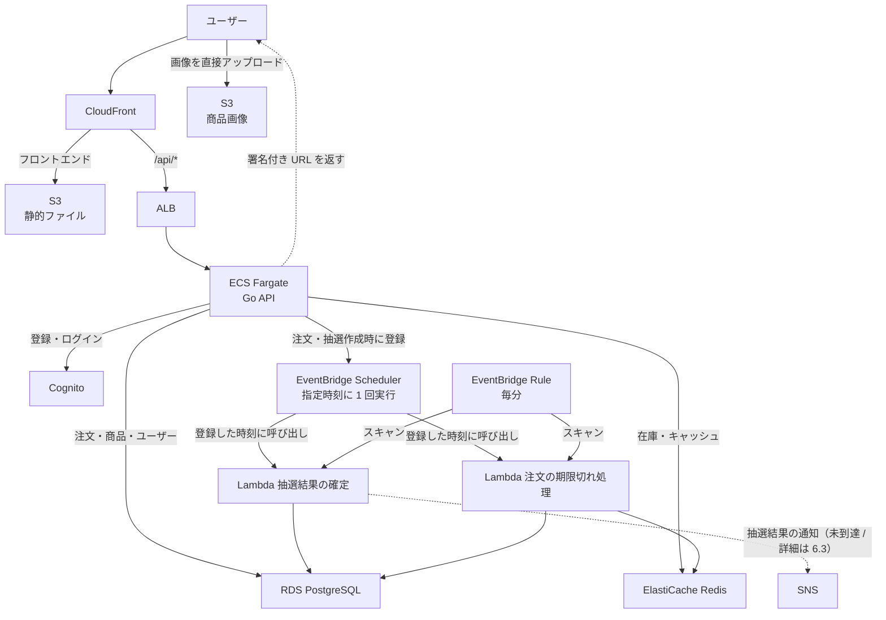
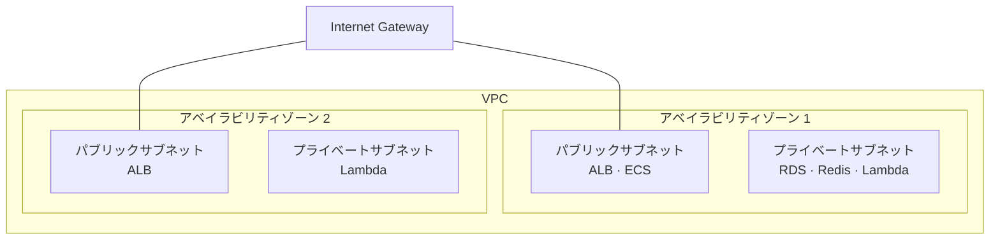
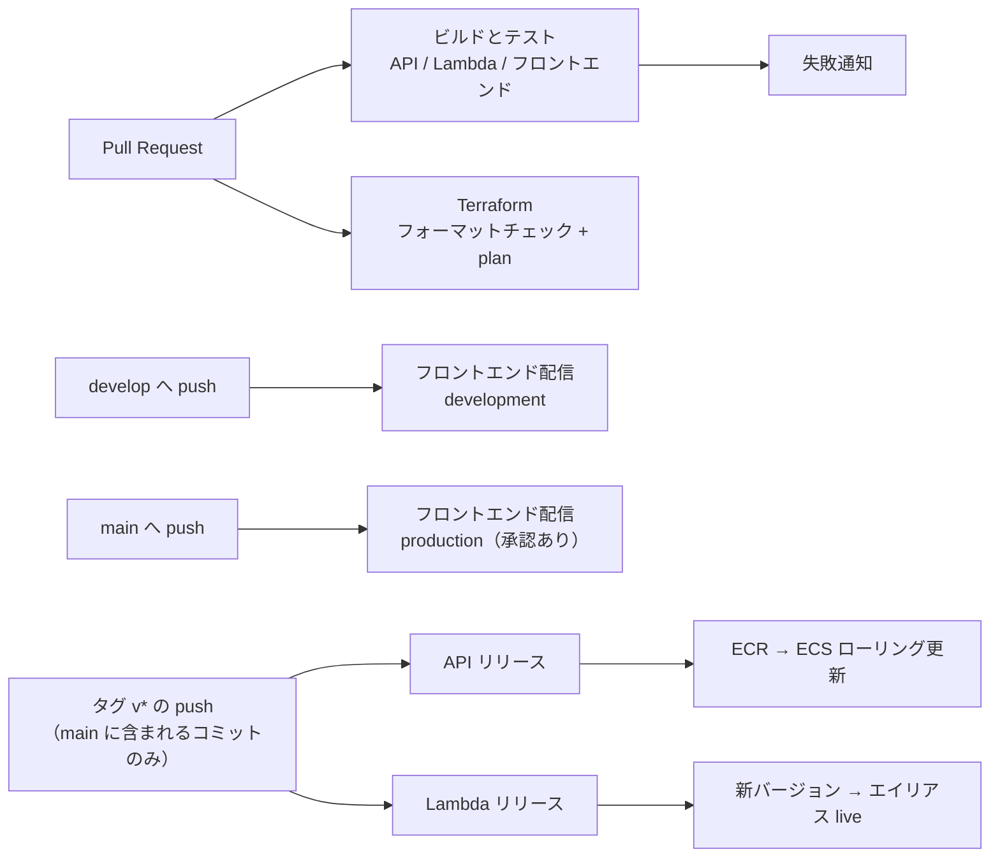
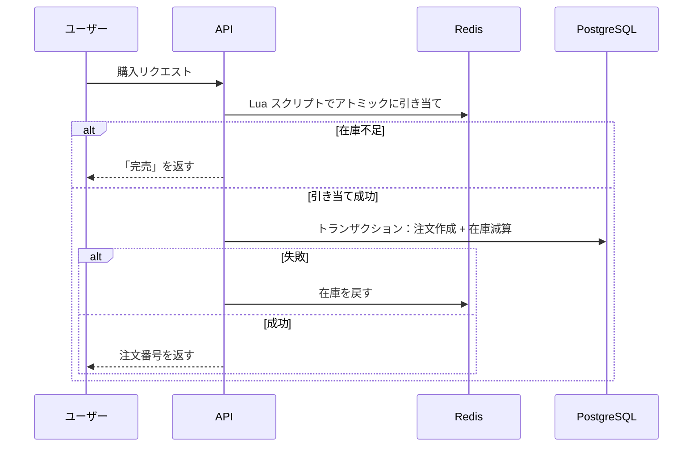

# FlashBuy

日本語 | [中文](README_zh.md)

FlashBuy は、数量限定のフラッシュセールと公平な抽選を提供する EC システムです。Go（Gin）+ PostgreSQL / React で実装し、AWS 上にデプロイしています。インフラと CI/CD は、それぞれ Terraform と GitHub Actions が担っています。決済はモック実装であり、サーバー側で確率に基づき成否をシミュレーションする仕様としています。

k6 による負荷試験を実施し、この構成の処理上限を測定しています。

デモサイト：<https://d3vk1w3oavfogf.cloudfront.net>

ログイン画面のボタンから、USER / ADMIN としてワンクリックでログインできます。管理者でログインすると抽選の作成まで試せます。

---

## 目次

1. [アーキテクチャと処理フロー](#1-アーキテクチャと処理フロー)
2. [AWS インフラストラクチャ](#2-aws-インフラストラクチャ)
3. [IaC と CI/CD](#3-iac-と-cicd)
4. [売り越し防止と公平な抽選](#4-売り越し防止と公平な抽選)
5. [トラブルシューティング事例](#5-トラブルシューティング事例)
6. [その他](#6-その他)
7. [License](#7-license)

---

## 1. アーキテクチャと処理フロー

### 1.1 技術スタック

| 分類 | 技術 |
|---|---|
| フロントエンド | React 19 / TypeScript / Vite / Tailwind CSS |
| バックエンド | Go 1.26 / Gin / sqlx / zap / viper |
| データベース・キャッシュ | PostgreSQL 15（RDS）、Redis 7.1（ElastiCache） |
| 認証 | Amazon Cognito |
| コンピューティング | ECS Fargate（ARM64）、Lambda（Go、ARM64） |
| スケジューリング | EventBridge Scheduler / Rule |
| 静的ホスティング | S3 + CloudFront |
| IaC / CI/CD | Terraform、GitHub Actions（OIDC） |
| 監視 | CloudWatch、SNS |

### 1.2 全体構成



### 1.3 業務フロー

**フラッシュセール**

```
1. Cognito の JWT と販売期間を検証し、期間外なら即座に拒否する
2. Redis の Lua スクリプトでアトミックに在庫を引き当てる。在庫がなければ「完売」を返す
3. トランザクションで注文を作成（UNPAID、期限は現在時刻 + 15 分）し、データベースの在庫を減算する
4. Scheduler に期限時刻のワンタイムスケジュールを登録する
5. 注文番号を返す
```

注文処理は即時性が求められるため、Redis を用いて同期的に在庫を引き当てます。一方、期限切れに伴う注文キャンセルと在庫の復元は、独立した非同期バッチとして Lambda が担当します。

**抽選**

```
1. 管理者が抽選を作成すると、API が抽選時刻のワンタイムスケジュールを Scheduler に登録する
2. 抽選時刻に Lambda が応募者一覧を読み、当選者をランダムに選ぶ
3. 当選者は UNPAID となり 72 時間以内に支払う。それ以外は LOST となる
4. 期限を過ぎても未払いの注文は、注文の期限切れ処理 Lambda がキャンセルする
```

---

## 2. AWS インフラストラクチャ

リージョン：`ap-northeast-1`

### 2.1 ネットワーク

VPC は 2 つのアベイラビリティゾーンにまたがり、パブリックサブネットとプライベートサブネットをそれぞれ 2 つずつ配置しています。



- ALB のセキュリティグループは、CloudFront のマネージドプレフィックスリストからの通信のみを許可しています。
- ECS は ALB からのトラフィックのみ受け付けます（Scheduler や Cognito 等の AWS API 呼び出しを行うため、パブリックサブネットに配置しパブリック IP を付与しています）。
- **RDS・Redis・Lambda はすべてプライベートサブネットに配置**し、外部インターネットからの直接到達経路を遮断しています。RDS へのアクセスは VPC 内部の ECS および Lambda からのみ許可しています。
- 固定費削減のため NAT Gateway および VPC エンドポイントは未配置としています（この構成による影響は [6.3](#63-既知の制限と今後の対応) を参照）。

### 2.2 エントリポイントとコンピューティング

- **CloudFront**：デフォルトパスは S3、`/api/*` は ALB へ転送し、API のパスはキャッシュしません。配信用の S3 バケットは非公開で、CloudFront からの読み取りのみ許可しています。
- **ECS Fargate**：ARM64、0.25 vCPU / 512 MB、タスクは常時 1 つ。アプリケーションはステートレスに設計しています。
- **ローリング更新**：新旧タスクを並存させて無停止で入れ替えます。起動に失敗した場合は circuit breaker で自動ロールバックします。
- **Secrets Manager**：DB パスワードを保管し、コンテナ起動時に環境変数として注入します。

### 2.3 データと認証

- **RDS PostgreSQL 15**：`db.t4g.micro`（ARM64）、シングル AZ、ストレージ暗号化、削除保護あり。現状の低負荷要件に適しています。初期化は VPC 内の一時的な Fargate タスクで実行します（`scripts/db-run.sh`）。
- **ElastiCache Redis 7.1**：シングルノード、プライベートサブネットに配置。在庫のリアルタイム判定とキャッシュを担います。
- **S3**：商品画像はブラウザから署名付き URL で直接アップロードします。API は署名付き URL を発行するだけです。
- **Cognito**：トークンの有効期限は access / id が 24 時間、refresh が 30 日です。API は公開鍵で JWT の署名をローカル検証します。ロールは `users` テーブルに保持し、Redis に 5 分キャッシュします。

### 2.4 非同期処理：Lambda と EventBridge

Lambda 関数は 2 つあります。**注文の期限切れ処理**と**抽選結果の確定**です。いずれも実行タイミングが明確で、1 回の実行は数秒で完了します。リアルタイム応答も不要なため、呼び出し回数に応じた課金の Lambda に向いています。

各関数には独立した 2 つのトリガーパスがあり、両方が同時に有効です。

| | パス 1：対象を指定して実行 | パス 2：毎分スキャン |
|---|---|---|
| トリガー | API が業務イベントの発生時に Scheduler へワンタイムスケジュールを登録し、登録した時刻に Scheduler が Lambda を呼び出す | EventBridge Rule が毎分 Lambda を呼び出す |
| 注文の期限切れ処理 | 注文成功時に「現在時刻 + 15 分」のスケジュールを登録し、期限までに未払いならキャンセルして在庫を戻す | 期限を過ぎた未払い注文（フラッシュセールと抽選の両方）をスキャンする |
| 抽選結果の確定 | 抽選の作成時に抽選時刻のスケジュールを登録し、登録した時刻に結果を確定する | 抽選時刻が経過後に「応募中」の記録が残るものをスキャンする |

- 2 つのパスは同一の Lambda 関数を呼び出しますが、ペイロード内の `mode` フィールド（`cancel` / `draw` / `scan`）で処理を分岐させ、コードの重複を防ぎつつ冪等性を担保しています。

### 2.5 監視とアラーム

CloudWatch のネイティブ機能で、メトリクス・ログ・アラーム・ダッシュボードを一元化しています。ALB の 5xx、RDS の接続数、Redis の Evictions などを 14 個のアラームで監視し、SNS のメール購読へ通知します。

閾値はインフラ側の制約から決めています。たとえば RDS の接続数は、`max_connections` が 79 で実際に使えるのが約 65 本であるのに対し、60 でアラームを上げます。プールの枯渇で接続が拒否される前に気づくためです。アプリのエラーは HTTP 200 で返るため ALB の 5xx では拾えません。ログの `level=error` をメトリクス化し、5 分間に 5 件で通知しています。

### 2.6 コスト管理

用途に応じてクラウド環境を作成・削除する 2 つのスクリプトを用意しています。

- `scripts/spinup.sh`：依存関係の順に全リソースを作成し、ALB のヘルスチェックが通ることと、CloudFront 経由で API がデータを返すことを確認します。
- `scripts/spindown.sh`：課金対象のリソースを逆順に削除し、月額を約 76 ドルから約 1 ドルまで下げます。`frontend` / `auth` / `state` / `shared` / `storage` は残します。特に `auth` は必須です。Cognito を作り直すと `sub` が変わり、`init_db.sql` のシードユーザーと一致しなくなるためです。

停止中は画面を表示できますが API は利用できません（ALB は `compute` とともに削除されます）。`spinup.sh` を実行すると復旧します。

### 2.7 選定とトレードオフ

| 論点 | 採用 | 代替案 | 理由 |
|---|---|---|---|
| API の実行形態 | ECS Fargate | EC2 上での自前運用、API 全体を Lambda に載せる | サーバー運用が不要な点と、常駐プロセスにより Redis コネクションプールを効率的に再利用できるため（Lambda は接続管理とコールドスタートの課題あり） |
| 在庫判定 | Redis でリアルタイム判定、PostgreSQL を永続記録とする | データベースの行ロックのみ | 大量リクエスト時の行ロック競合による待ち行列と遅延増幅を防止するため |
| 認証 | Cognito | JWT の自前発行 | パスワードハッシュ化、トークン発行、公開鍵ローテーションの実装・運用負荷を排除するため |
| CI/CD | GitHub Actions + OIDC | CodePipeline | ソースコードと一元管理でき、OIDC により長期クレデンシャル管理を不要化するため |

---

## 3. IaC と CI/CD

### 3.1 Terraform

9 つのモジュールに分割し、それぞれ独立した state を持ちます。変更頻度とライフサイクルで分けており、リリースごとに変わる `compute` / `lambda` と、ほとんど変えない `data` などの基盤層が別です。`lambda` / `compute` / `frontend` は `terraform_remote_state` で上流の出力を参照し、`monitoring` はリソース名で検索します。

変更した層だけを apply でき、環境を層ごとに破棄・再作成できます。トレードオフは、層をまたぐ変更では依存順に複数回 apply する必要があることです。

### 3.2 CI/CD パイプライン

AWS の認証はすべて GitHub OIDC で取得した一時認証情報を使用しています。workflow は 7 本です。



PR では API / Lambda / フロントエンドのビルドとテスト、Terraform のフォーマットチェックと 8 モジュールの並列 plan が走ります。タグ `v*` の push で API と Lambda が同時にリリースされ、失敗時は復旧まで Issue が自動で開いたままになります。

`apply` は誤操作によるデータ消失を防ぐため、ローカルでの手動実行に限定しています。差分は PR の plan で確認し、state は S3 ネイティブロック（`use_lockfile`）で同時実行を防いでいます。単一環境・単独開発なら、この 2 つで十分と判断しました。CI のロールには ECR push と ECS 更新のみを与え、インフラ変更権限は渡していません。

### 3.3 リリースとロールバック

- **API リリース**：イメージを push し、タスク定義のイメージだけを差し替えて新しい revision を登録、サービスを更新して安定を待ちます。自動ロールバックでもサービスは stable になるため、最後に稼働中の revision を比較して「成功」と「失敗後のロールバック」を区別します。
- **Lambda リリース**：コードを更新して完了まで待機 → 新しいバージョンを発行 → `live` エイリアスを切り替えます。トリガーはすべてエイリアスを指しています。
- **ロールバック**：Lambda は `update-alias` で旧バージョンに、API は `update-service` で旧 revision に戻します。コマンドはどちらも 1 回で済みます。Lambda は即時に切り替わり、API は ECS のローリング更新が完了した時点で戻ります。
- **デプロイ運用ルール**：
  - 整合性保護：テスト等のチェックジョブは中断を許容し、デプロイジョブは並行・中断不可
  - 責務分離：リソース構造は Terraform、デプロイバージョンは CI が管理（`ignore_changes`）
  - リリース制約：タグが指すコミットは main ブランチに含まれることを必須とし、develop → main → tag のリリースフローを強制

### 3.4 権限設計

- GitHub Actions は用途ごとに 5 つの IAM ロールを使い分け、権限をリソース範囲で絞っています。API リリース用のロールは ECR への push と ECS の更新だけを持ち、インフラの変更権限はありません。
- GitHub Environments のデプロイ制限：`development` は `develop` ブランチと `v*` タグ、`production` は `main` のみを許可し、人手による承認を要求します。
- Terraform plan のジョブは同一リポジトリの PR に限定しています。plan ロールは state バケット（DB パスワードを含む）を読めるため、公開リポジトリでは fork からの PR が PR 側の workflow 定義で実行され、認証情報を窃取される恐れがあります。

---

## 4. 売り越し防止と公平な抽選

### 4.1 売り越し防止

フラッシュセールでは短時間にリクエストが集中します。すべてのリクエストがデータベースの同じ行に対して `stock = stock - 1` を実行すると、行ロックで待ち行列が発生します。そこで在庫のリアルタイム判定は Redis に置き、データベースは最終的な記録として扱います。



1. **Redis によるアトミックな引き当て**：Lua スクリプトで「在庫の読み取り、在庫が残っているかどうかの判定、減算」を 1 回の呼び出しにまとめ、実行中は Redis が他のコマンドを処理しません
2. **データベースの条件付き更新**：トランザクション内で `UPDATE ... WHERE stock > 0` を実行します。テーブルには `CHECK (0 <= stock <= total_stock)` 制約もあり、最後の砦として機能します
3. **失敗時の在庫戻し**：データベースのトランザクションが失敗した場合、Redis の在庫を戻します

補足：

- 在庫キーに TTL は設定していません。在庫は取引データであり、期限切れになると実際の値と乖離するためです。初回アクセス時にデータベースから読み込み、同時に読み込んだ場合は先に書き込まれたものを採用します。
- Redis が利用できない場合、読み取りは自動的にデータベースへフォールバックします。購入はフォールバックせず、在庫判定に失敗した時点でシステムエラーを返します。

### 4.2 注文の期限切れ処理

未払い注文の放置による在庫の滞留を防ぐため、以下の仕組みで安全にキャンセルと在庫復元を行います（トリガー経路は [2.4](#24-非同期処理lambda-と-eventbridge) を参照）。

- **再実行可能**：キャンセルの SQL には状態条件（未払い）と期限条件の両方が付いています。重複して実行しても、ユーザーがちょうどその時刻に支払っても、支払済みの注文は変更されません。
- **キャンセルと在庫戻しを同一トランザクションで行う**：別々にコミットすると、注文はキャンセルされたのに在庫が戻らない行が残ります。その行は以降スキャン対象にならないため、在庫は永久に戻りません。

### 4.3 公平な抽選

抽選の時刻指定実行と毎分スキャンが同じ抽選を同時に処理する可能性があるため、抽選結果が 1 回だけ生成されることを保証する必要があります。トランザクションの手順は次のとおりです。

1. 対象の抽選レコードに行ロック（`FOR UPDATE`）をかけ、競合した側は待機します
2. 「応募中」のレコードをすべて読み取ります。0 件なら抽選済みと判断して終了します
3. 暗号学的に安全な乱数でシャッフル（Fisher-Yates）し、先頭 N 件を当選者とします
4. 応募者をすべて「落選」に更新した後、当選者を「未払い」に変更し、72 時間の支払期限を書き込みます
5. コミット後に SNS へイベントを発行します（タイムアウト 3 秒、失敗しても抽選結果には影響しません）

- 行ロックは、抽選処理が同時に実行されたときの上書きを防ぐために必要です。行ロックがないと、後から来た側が先に確定した「落選」を「未払い」に戻してしまい、当選者数が枠を超えます。
- 重複応募は `UNIQUE (user_id, lottery_id)` 制約で防いでおり、データベース層でアトミックに判定します。

### 4.4 負荷試験

k6（JMeter と同じ負荷試験ツール）の constant-arrival-rate で、稼働中の環境の `POST /api/v1/flash/buy` を呼び出しました。経路は CloudFront → ALB → ECS Fargate（0.25 vCPU / 512 MB、タスク 1 つ）→ RDS `db.t4g.micro` / ElastiCache です。成功したリクエストは 1 件につきデータベースへの書き込み 1 回と Scheduler へのスケジュール登録 1 回を行います。

**購入経路**（在庫 100,000、1 回 15〜30 秒）

| 目標レート | 実測スループット | p95 | 結果 |
|---|---|---|---|
| 50 req/s | 49.9 req/s | 49 ms | エラーなし |
| 120 req/s | 118.5 req/s | 56 ms | エラーなし |
| 150 req/s | 138.9 req/s | 1.17 s | 処理は可能だが p95 が 1 秒超 |
| 200 req/s | 84.7 req/s | 5.45 s | 処理能力を超え、473 件を送信できず |

p95 は全リクエストの 95% がその時間内に返った値です。120 req/s までは 50 ms 前後で安定し、RDS の CPU は 10% 未満でした。200 req/s はタスク 1 つの処理能力を超え、実測は 84.7 req/s まで落ちています。能力を超えた後も 5xx は出ておらず、ボトルネックは 0.25 vCPU です。

**接続プール**

最初のコードではプール上限が 100 でしたが、150 req/s で 239 件の 500 が出ました。RDS の `max_connections` は 79 で、予約枠を除くと約 65 本しか使えないためです。50 に下げると 500 は 0 になり、処理量は 112.3 → 138.9 req/s に増えました。50 にしたのは、期限切れ処理の Lambda に接続を残すためです。

**売り越し**（在庫 200、100 req/s で 15 秒、計 1,501 リクエスト）

| 項目 | 結果 |
|---|---|
| 注文成功 | 200 |
| `10001` の返却 | 1,301 |
| `oversell_check` | PASS |

在庫は 2 秒で売り切れ、以降は Redis の判定だけで返ります。全リクエストを同時に発行する試験でも、成功数は在庫数と一致しました。プール変更の前後どちらも、在庫と注文の合計は一致しています。

**制約**

タスク 1 つ、シングル AZ の RDS、シングルノードの Redis という構成なので、上の数字は現在のスペックにのみ当てはまります。タスク数を増やす場合やインスタンスクラスを変える場合は再測定が必要です。

---

## 5. トラブルシューティング事例

### 5.1 抽選スケジュールの登録が失敗しても、エラーが報告されない

- **現象**：抽選作成の API は成功を返しますが、Scheduler に抽選スケジュールが存在しませんでした。
- **原因**：`CreateSchedule` の認可対象は schedule group 配下の `schedule/<group>/*` です。IAM ポリシーのリソース ARN に schedule group 自体の ARN を指定していたため、呼び出しが拒否されていました。API は登録の失敗をログに記録するだけで、レスポンスは成功を返していました。
- **対応**：ARN を修正し、毎分スキャンを必須の構成要素として残しました。このため、2 つのトリガーパスを併用しています。

### 5.2 プライベートサブネット内の Lambda が AWS API 呼び出しで待ち続ける

NAT も VPC エンドポイントも配置していない構成（[2.1](#21-ネットワーク)）による、想定内のタイムアウトです。ここでは SDK の再試行にどう対応したかを記載します。

- **現象**：Lambda からの SNS 発行に 51 秒かかり、呼び出しが長時間返りませんでした。同種の呼び出しは関数のタイムアウトまで待ち続ける状態でした。
- **原因**：VPC に NAT Gateway も VPC エンドポイントもないため、接続要求に対する応答が返らず、SDK が再試行を続けていました。
- **対応**：
  - DB パスワードを環境変数で注入する方式に変更しました（VPC 内の Lambda から Secrets Manager へ到達できないため）。
  - 抽選関数のスケジュール登録は、環境変数を渡さないことで停止しました（コードは保持しており、再注入で復旧可能）。72 時間の支払期限は毎分スキャンが処理します。
  - 外部呼び出しには短いタイムアウト（SNS は 3 秒）を設定しました。

### 5.3 スケジュールがデータベース上の期限より数ミリ秒早く実行される

- **現象**：注文の期限が切れても在庫がすぐに戻らず、次の毎分スキャンまで反映されませんでした。
- **原因**：データベースに書き込む期限時刻と、スケジュールを登録する時刻で現在時刻をそれぞれ取得しており、数ミリ秒の差が生じていました。スケジュールがデータベース上の期限より早く発火し、「まだ期限切れではない」と判定されてキャンセルされず、ワンタイムスケジュールは実行後に削除されていました。
- **対応**：期限時刻の計算を 1 回だけ行い、データベースへの書き込みとスケジュール登録で同じ値を使うように修正しました。

## 6. その他

### 6.1 API の仕様

すべてのレスポンスは HTTP 200 で返し、結果はボディの `code` で表します。`0` は成功、業務エラーは `10001`（在庫なし）、`10002`（重複応募）、`10003`（支払期限切れ）、`10004`（購入済み）。パラメータ・認証・権限・システムエラーは、HTTP ステータスではなくボディの `code` に `400` / `401` / `403` / `500` を入れます。

制約：フロントエンドが SPA で、CloudFront の SPA フォールバックが 403 / 404 を index.html に置き換えます。HTTP ステータスとして 403 / 404 を返すと、フロントは HTML を受け取ることになります。そのため HTTP は常に 200 とし、区別はボディの `code` で行っています。監視については [2.5](#25-監視とアラーム) を参照してください。

### 6.2 テスト

テストは Lambda と購入 API に置いています。注文の期限切れ処理に 13 個、抽選ロジックに 4 個（当選人数、重複・漏れがないこと、入力データを変更しないこと、乱数の偏り）、購入 API に 3 個（在庫なし、重複購入、DB 在庫切れ時のロールバック）があり、いずれも CI で実行されます。

購入 API のテストは、在庫の引き当てとトランザクションの境界だけを対象にしています。DB と Redis は `sqlmock` と `miniredis` で置き換え、コンテナを起動せずに分岐と巻き戻しを検証します。`testcontainers` のような実コンテナは使っていません。CI の実行時間を伸ばさないためです。

### 6.3 既知の制限と今後の対応

| 項目 | 内容（費用は東京リージョンの月額概算） |
|---|---|
| 抽選結果の通知 | **現状**：当選者へ結果を通知する仕組みがありません。抽選後に SNS へ発行していますが、Lambda は VPC 内にいてインターネットに出られないため、呼び出しはタイムアウトします。この失敗は Lambda の Errors に計上されないので、アラームも鳴りません。<br>**次のステップ**：SNS のインターフェース VPC エンドポイントを追加し（2 AZ で月約 14 ドル）、トピックに購読先を設定します |
| ネットワークと鍵管理 | **現状**：NAT も VPC エンドポイントもないため、Lambda から AWS API を呼べません。DB パスワードは環境変数で渡しています。<br>**次のステップ**：SNS と Secrets Manager のエンドポイントを追加し（月約 29 ドル）、パスワード管理を Secrets Manager に戻します |
| 当選枠の期限切れ後に繰り上げがない | **現状**：期限切れは `CANCELLED` にするだけで、空いた枠は次の人に回りません。これは純粋なビジネスロジックの話で、アーキテクチャとは関係ありません。<br>**次のステップ**：抽選時に順位を記録し、キャンセル時に次点へ枠を渡して支払期限を再設定します |
| 可用性 | **現状**：ECS 1 タスク、RDS シングル AZ、Redis シングルノード。`/ping` はプロセスの生存のみで、依存先が落ちてもタスクは切り離されません。prod のフロントエンドも dev の ALB を参照しています。<br>**次のステップ**：タスクを 1 つ追加し（月約 11 ドル）、`/ready` で依存先を確認します。prod は独立したバックエンドに分けます |
| データ整合性 | **現状**：トランザクション失敗後の Redis 復元は 1 回だけで、プロセスの異常終了や復元失敗はそのまま残ります。<br>**次のステップ**：DB を正として在庫キーを定期的に作り直すか、照合スクリプトを用意します |

### 6.4 開発体制

個人開発です。期間は約 11 週間（2026-08 から 2026-10）で、AWS インフラ、Terraform、GitHub Actions、設計、デプロイ後の確認とトラブルシューティングを担当しました。Go とフロントエンドのコード作成は生成 AI の補助を受けています。

### 6.5 ローカルでの実行

```bash
cd api && docker compose up -d                 # PostgreSQL 15 + Redis 7
PGPASSWORD=postgres psql -h localhost -U postgres -d flashbuy -f init_db.sql
APP_ENV=local go run ./cmd/server              # API :8080
cd ../frontend && pnpm install && pnpm dev     # フロントエンド :5173
```

`APP_ENV` のデフォルトは `dev`（クラウド接続用）なので、ローカルでは `APP_ENV=local` を明示します。認証は実際の Cognito に接続するため、AWS 認証情報が必要です。クラウド環境の構築は `scripts/spinup.sh` が行います。


## 7. License

[MIT License](LICENSE)
