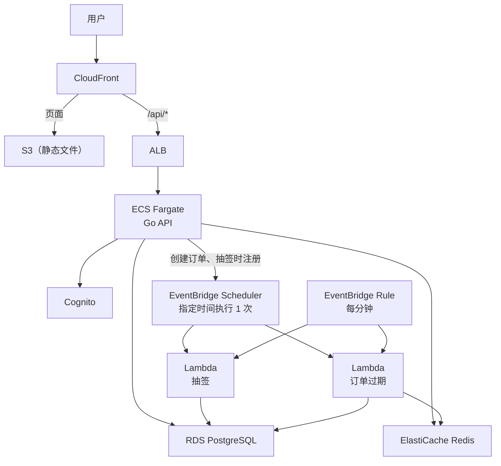

# FlashBuy

[日本語](README.md) | 中文

一个用「抽签」和「先到先得」两种方式销售限量商品的电商网站。API 用 Go，页面用 React，部署在 AWS 上。基础设施用 Terraform 管理，部署用 GitHub Actions。

重点做了两件事：

- 请求集中时也不会卖超（订单数不超过库存）
- 一个人也能运维的基础设施（自动部署、自动回滚、监控、成本控制）

| | |
|---|---|
| 演示 | <https://d3vk1w3oavfogf.cloudfront.net>（登录页的按钮可以直接以普通用户 / 管理员身份登录） |
| 期间 | 2026年8月〜10月（约 11 周），个人开发 |
| 支付 | 模拟实现，服务端有 40% 的概率返回失败 |

> 为了省钱，不用的时候会停掉 API 等资源（见 [5.4](#54-成本)）。页面能打开但没有数据，就是停机中。

---

## 目录

1. [架构](#1-架构)
2. [主要流程](#2-主要流程)
3. [防超卖](#3-防超卖)
4. [压力测试](#4-压力测试)
5. [基础设施](#5-基础设施)
6. [IaC 与 CI/CD](#6-iac-与-cicd)
7. [排障案例](#7-排障案例)
8. [已知问题](#8-已知问题)
9. [测试](#9-测试)
10. [本地运行](#10-本地运行)

---

## 1. 架构



| 分类 | 技术 |
|---|---|
| 前端 | React 19 / TypeScript / Vite / Tailwind CSS |
| 后端 | Go 1.26 / Gin / sqlx / go-redis |
| 数据库・缓存 | RDS PostgreSQL 15、ElastiCache Redis 7.1 |
| 认证 | Cognito |
| 运行环境 | ECS Fargate（ARM64）、Lambda（Go、ARM64） |
| 异步处理 | EventBridge Scheduler / Rule |
| 静态分发 | S3 + CloudFront |
| IaC / CI/CD | Terraform、GitHub Actions（OIDC） |
| 监控 | CloudWatch、SNS |

选 ECS Fargate，是因为不用管服务器，而且常驻进程能复用数据库和 Redis 的连接。订单过期和抽签都是在固定时间点跑几秒就结束的任务，所以用 Lambda。

---

## 2. 主要流程

### 先到先得

1. 校验 JWT 和销售时间
2. 在 Redis 里把库存减 1，没有库存就返回「已售罄」
3. 在事务里创建订单（未支付，支付期限为 15 分钟后），同时把数据库库存减 1
4. 在 Scheduler 注册一个在支付期限时刻执行的一次性任务
5. 返回订单号

### 抽签

1. 管理员创建抽签时，注册抽签时刻的一次性任务
2. 到时间后，Lambda 从报名者中选出中签者（用 `crypto/rand` 洗牌）
3. 中签者需在 72 小时内支付，过期的订单会被取消

### 两种触发方式

Lambda 会被下面两种方式调用：

| | Scheduler | EventBridge Rule |
|---|---|---|
| 时间 | 注册的时刻执行 1 次 | 每分钟 |
| 对象 | 1 个订单或抽签 | 所有已过期但还没处理的 |
| 作用 | 按时处理 | 兜底，捡漏 |

Scheduler 注册失败也没关系，每分钟的扫描会处理。同一个对象被两边同时处理，结果也不会出错：取消订单的 SQL 只更新「未支付」且「已过期」的订单，抽签会先锁住对应的行（`FOR UPDATE`）再处理。

---

## 3. 防超卖

所有购买请求都去更新数据库的同一行的话，行锁等待会越来越长。所以库存先在 Redis 判断，数据库作为最终记录。

库存在 3 个地方检查：

1. **Redis**：用 Lua 脚本把「检查库存」和「减 1」放在一次调用里执行。Redis 执行脚本期间不处理其他命令，所以并发请求也不会把库存减到负数
2. **数据库**：执行 `UPDATE ... SET stock = stock - 1 WHERE stock > 0`，更新行数为 0 就回滚
3. **CHECK 约束**：表上有 `CHECK (0 <= stock <= total_stock)`

数据库处理失败时，把 Redis 的库存加回 1。同一用户重复购买同一商品，用部分唯一索引（未支付・已支付订单的 `user_id, flash_id`）防止。

Redis 的库存在第一次访问时从数据库读入，不设过期时间（TTL）。Redis 不可用时，商品展示会改读数据库，但购买直接返回错误。

---

## 4. 压力测试

用 k6 按固定速率请求线上环境的购买 API。

- 配置：ECS 任务 1 个（0.25 vCPU / 512 MB）、RDS db.t4g.micro、Redis 1 个节点
- 每轮 15〜30 秒，库存 100,000

| 目标 | 实际吞吐 | p95 | 结果 |
|---|---|---|---|
| 50 req/s | 49.9 req/s | 49 ms | 无错误 |
| 120 req/s | 118.5 req/s | 56 ms | 无错误 |
| 150 req/s | 138.9 req/s | 1.17 s | 能处理，但变慢 |
| 200 req/s | 84.7 req/s | 5.45 s | 处理不过来，473 个请求没能发出 |

每秒 120 个请求以内是稳定的。RDS 的 CPU 不到 10%，瓶颈是 ECS 的 CPU（0.25 vCPU）。到 200 req/s 也没有出现 5xx。

**连接池**：一开始连接池上限是 100，150 req/s 时出了 239 个 500 错误。原因是 RDS 的 `max_connections` 只有 79，去掉预留后实际只能用 65 个左右。把上限改成 50 后，错误降到 0，吞吐也从 112.3 升到 138.9 req/s。剩下的连接留给 Lambda。

**超卖**：库存 200，15 秒内发 1,501 个请求，结果订单 200 个，其余 1,301 个返回「已售罄」（`10001`）。

这些数字只适用于当前配置，增加任务数或换实例规格后需要重新测。

---

## 5. 基础设施

区域是 `ap-northeast-1`。

### 5.1 网络

- VPC 跨 2 个 AZ，公有子网和私有子网各 2 个
- ALB 在公有子网，安全组只允许来自 CloudFront（托管前缀列表）的流量
- ECS 放在公有子网并分配公网 IP。因为没有 NAT，要调用 Scheduler、Cognito 的 API 只能这样。入站只接受来自 ALB 的流量
- RDS、Redis、Lambda 在私有子网
- 出于成本考虑，没有配置 NAT Gateway 和 VPC 端点（影响见 [8](#8-已知问题)）

### 5.2 认证与权限

- API 用公钥在本地校验 Cognito 的 JWT（签名、`iss`、`exp`、`token_use`、`aud`）
- 数据库密码放在 Secrets Manager，ECS 任务启动时作为环境变量注入
- GitHub Actions 通过 OIDC 获取临时凭证。IAM 角色按用途分成 5 个，API 部署用的角色只能 push ECR 和更新 ECS

### 5.3 监控

- CloudWatch 告警共 14 个（ALB、ECS、RDS、Redis、Lambda、应用错误日志），通过 SNS 发邮件
- API 的业务错误用 HTTP 200 返回，ALB 的 5xx 抓不到。所以把日志里的 `level=error` 做成指标，5 分钟内 5 条以上就告警
- RDS 连接数到 60 就告警。实际可用约 65，要在用完之前发现
- Redis 的 Evictions 等指标在看板上看

### 5.4 成本

全部开着每月约 76 美元。用 `scripts/spindown.sh` 删掉 ALB、ECS、RDS、Redis、Lambda 等计费资源后，每月约 1 美元。`scripts/spinup.sh` 按依赖顺序重建，导入数据库初始数据，一直确认到 API 能正常返回。

Cognito 不删。重建后用户 ID（`sub`）会变，和初始数据对不上。

---

## 6. IaC 与 CI/CD

### 6.1 Terraform

`terraform/` 分成 9 个目录，各自有独立的 state（S3，用 `use_lockfile` 加锁）。经常改的 `compute`、`lambda` 和基本不动的 `data` 等分开，一次 apply 影响的范围更小。

apply 在本地手动执行。PR 时会自动跑格式检查和 8 个目录的 plan，差异在那里确认。

### 6.2 GitHub Actions

| workflow | 内容 |
|---|---|
| `api-ci` / `lambda-ci` | push 到 `develop`・`main` 和 PR 时，构建并测试 |
| `api-cd` | 打 `v*` 标签时构建 ARM64 镜像，push 到 ECR，滚动更新 ECS |
| `lambda-cd` | 打 `v*` 标签时更新代码、发布新版本，切换别名 `live` |
| `frontend` | `develop` 发布到开发环境，`main` 发布到正式环境（需要审批）。上传到 S3，清除 CloudFront 上 `index.html` 的缓存 |
| `terraform` | PR 时做格式检查和 plan |
| `ci-notify` | CI 失败时自动创建 GitHub Issue |

- 标签只能打在已经合入 `main` 的提交上
- ECS 开了熔断器（circuit breaker），新任务起不来会自动回滚。回滚后服务也会变成稳定状态，所以最后会比对正在运行的任务定义，判断是成功还是回滚了
- 手动回滚时，ECS 改回上一个任务定义，Lambda 把别名指回上一个版本，都是一条命令

---

## 7. 排障案例

### 7.1 抽签任务没注册上，却没有报错

- **现象**：创建抽签成功，但 Scheduler 里没有对应的任务
- **原因**：IAM 策略的资源写成了 schedule group 本身的 ARN，正确的是它下面的 `schedule/<group>/*`。API 注册失败只记了日志，仍然返回成功
- **处理**：改正 ARN。为了注册失败时也不漏处理，保留了每分钟的扫描

### 7.2 Lambda 发 SNS 用了 51 秒

- **现象**：抽签后发送 SNS 迟迟不结束
- **原因**：没有 NAT 和 VPC 端点，私有子网里的 Lambda 连不到 SNS，SDK 一直在重试
- **处理**：外部调用都加了超时（SNS 为 3 秒）。Lambda 也取不到 Secrets Manager，数据库密码改为用环境变量传入

### 7.3 过期订单没有及时取消

- **现象**：过了期限库存也没恢复，要等到下一次每分钟扫描
- **原因**：写入数据库的期限和注册任务的时间各自取了一次当前时间。任务早了几毫秒执行，被判断为「还没过期」
- **处理**：期限只算一次，数据库和任务用同一个值

---

## 8. 已知问题

| 问题 | 内容 | 对策 |
|---|---|---|
| 抽签结果通知 | Lambda 连不到 SNS，中签通知发不出去。这个失败不算 Lambda 的错误，告警也不会响 | 加 SNS 的 VPC 端点（每月约 14 美元） |
| 密码传递 | Lambda 的数据库密码用环境变量传 | 加 Secrets Manager 的端点后改回 |
| 可用性 | ECS 1 个任务、RDS 单 AZ、Redis 1 个节点。`/ping` 只检查进程是否存活 | 任务加到 2 个，健康检查也确认数据库和 Redis |
| 环境 | 正式环境的页面也在调用开发环境的 API | 给正式环境单独建后端 |
| 抽签递补 | 中签者没付款，空出的名额不会给下一个人 | 抽签时记录名次，取消时顺延 |

---

## 9. 测试

- 订单过期处理：13 个
- 抽签：4 个（中签人数、没有重复和遗漏、不修改输入、随机分布）
- 购买 API：3 个（无库存、重复购买、数据库库存不足时把 Redis 加回去）

购买 API 的测试用 `sqlmock` 替代数据库、`miniredis` 替代 Redis，不需要启动容器。所有测试都在 CI 里跑。

---

## 10. 本地运行

```bash
cd api && docker compose up -d                 # PostgreSQL 15 + Redis 7
PGPASSWORD=postgres psql -h localhost -U postgres -d flashbuy -f init_db.sql
APP_ENV=local go run ./cmd/server              # API :8080
cd ../frontend && pnpm install && pnpm dev     # 页面 :5173
```

不指定 `APP_ENV` 会用云端配置（`dev`），本地要加 `APP_ENV=local`。认证用的是 Cognito，需要 AWS 凭证。

---

## 关于开发

代码实现用了生成式 AI。设计、AWS 搭建、代码审查、验证、排障和处理都是自己做的。

## License

[MIT License](LICENSE)
