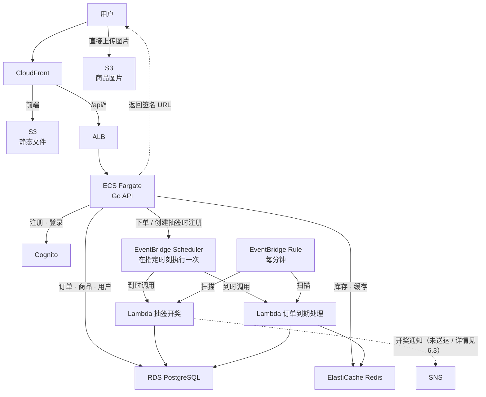
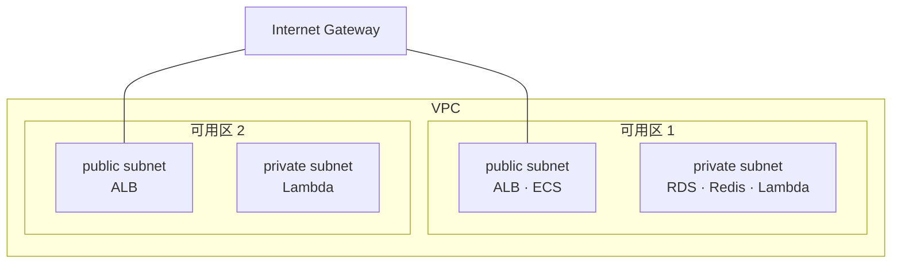
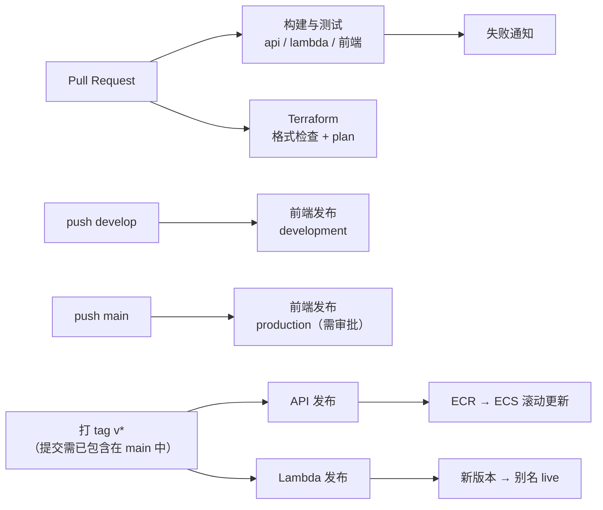
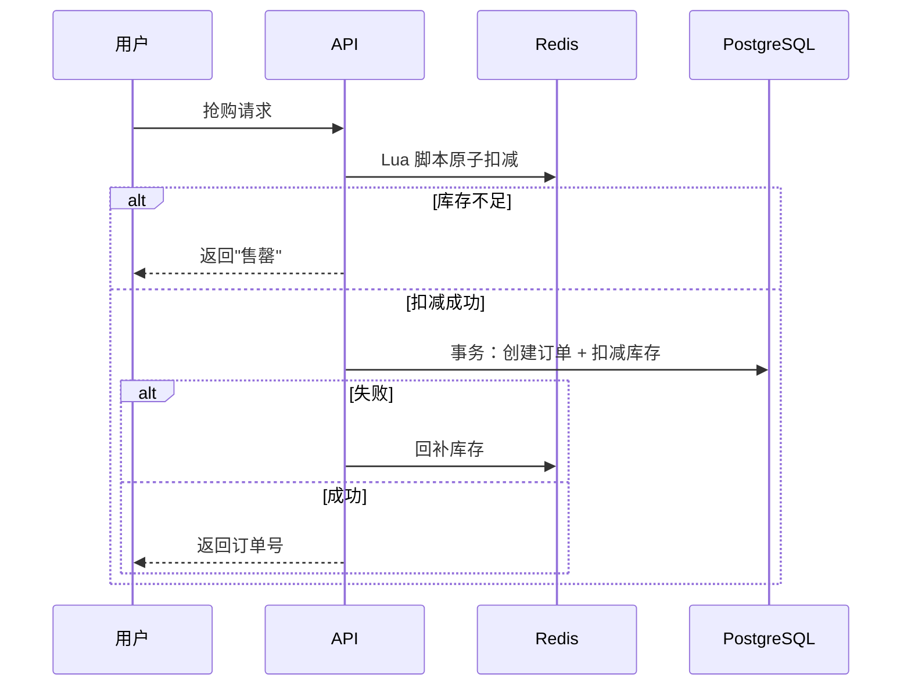

# FlashBuy

[日本語](README.md) | 中文

FlashBuy 是一个提供限量抢购与公平抽签两种服务的电商系统。使用 Go（Gin）+ PostgreSQL / React 实现，并部署在 AWS 上。基础设施和 CI/CD 分别由 Terraform 与 GitHub Actions 负责。支付为模拟实现，由服务端基于概率模拟返回支付成败。

用 k6 做过压力测试，测出了这套配置的处理上限。

在线演示：<https://d3vk1w3oavfogf.cloudfront.net>

登录页有一键演示登录按钮，可分别以普通用户和管理员身份进入。用管理员登录可以走通创建抽签的完整流程。

---

## 目录

1. [架构与流程](#1-架构与流程)
2. [AWS 基础设施](#2-aws-基础设施)
3. [IaC 与 CI/CD](#3-iac-与-cicd)
4. [防超卖与公平开奖](#4-防超卖与公平开奖)
5. [排查记录](#5-排查记录)
6. [其他](#6-其他)
7. [License](#7-license)

---

## 1. 架构与流程

### 1.1 技术栈

| 类别 | 选型 |
|---|---|
| 前端 | React 19 / TypeScript / Vite / Tailwind CSS |
| 后端 | Go 1.26 / Gin / sqlx / zap / viper |
| 数据库与缓存 | PostgreSQL 15（RDS）、Redis 7.1（ElastiCache） |
| 认证 | Amazon Cognito |
| 计算 | ECS Fargate（ARM64）、Lambda（Go，ARM64） |
| 调度 | EventBridge Scheduler / Rule |
| 静态托管 | S3 + CloudFront |
| IaC / CI/CD | Terraform、GitHub Actions（OIDC） |
| 监控 | CloudWatch、SNS |

### 1.2 整体架构



### 1.3 业务流程

**限量抢购**

```
1. 校验 Cognito JWT 与销售时间窗，非售卖期直接拒绝
2. Redis Lua 原子扣减库存；库存不足则返回"已售罄"
3. 事务写入订单（UNPAID，到期时间 = 当前时间 + 15 分钟）并扣减数据库库存
4. 向 Scheduler 注册到期时刻的一次性调度
5. 返回订单号
```

下单处理因用户需要即时响应，通过 Redis 进行同步库存扣减；订单超时取消与库存回补则作为独立的异步批处理交由 Lambda 执行。

**抽签**

```
1. 管理员创建抽签时，API 向 Scheduler 注册开奖时刻的一次性调度
2. 开奖时刻，Lambda 读取报名列表，随机抽出中奖者
3. 中奖者状态为 UNPAID，须在 72 小时内付款；其余为 LOST
4. 超期未付款的订单由订单到期处理 Lambda 取消
```


---

## 2. AWS 基础设施

区域：`ap-northeast-1`。

### 2.1 网络

VPC 跨 2 个可用区，public subnet 与 private subnet 各 2 个。



- ALB 的安全组只放行来自 CloudFront 托管前缀列表的通信；
- ECS 只接受来自 ALB 的流量（置于 public subnet 并分配公网 IP，以调用 Scheduler、Cognito 等 AWS API）；
- **RDS、Redis、Lambda 均严格部署在 private subnet**，完全阻断外部互联网的直接访问。RDS 仅放行来自 VPC 内 ECS 及 Lambda 的访问；
- 为控制固定成本未配置 NAT Gateway 与 VPC Endpoint（这一配置带来的影响见 [6.3](#63-已知限制与待办)）。

### 2.2 入口与计算

- **CloudFront**：默认路径指向 S3，`/api/*` 指向 ALB，API 路径关闭缓存；前端 S3 桶为私有，仅允许 CloudFront 读取。
- **ECS Fargate**：ARM64，0.25 vCPU / 512 MB，常驻 1 个任务，应用为无状态设计。
- **滚动更新**：新旧任务并存，无停机替换；启动失败时由 circuit breaker 自动回滚。
- **Secrets Manager**：存放 DB 密码，容器启动时以环境变量注入。

### 2.3 数据与认证

- **RDS PostgreSQL 15**：`db.t4g.micro`（ARM64），单 AZ，存储加密，开启删除保护。适合当前的低负载需求。初始化通过在 VPC 内启动一次性 Fargate 任务执行（`scripts/db-run.sh`）。
- **ElastiCache Redis 7.1**：单节点，位于 private subnet，承担库存实时判定与缓存。
- **S3**：商品图片由浏览器通过签名 URL 直传，API 只负责签发上传地址。
- **Cognito**：token 有效期 access / id 24 小时、refresh 30 天。API 用公钥在本地验证 JWT 签名；用户角色保存在 `users` 表，Redis 缓存 5 分钟。

### 2.4 异步任务：Lambda 与 EventBridge

两个 Lambda 函数：**订单到期处理**与**抽签开奖**。两类任务触发时机明确、无需实时响应、单次运行数秒即可完成，适合按调用计费的 Lambda。

每个函数有两条独立、同时存在的触发路径：

| | 路径 1：按对象精确触发 | 路径 2：每分钟扫描 |
|---|---|---|
| 触发者 | API 在业务事件发生时向 Scheduler 注册一次性调度，到时由 Scheduler 调用 Lambda | EventBridge Rule 每分钟调用 Lambda |
| 订单到期处理 | 下单成功时注册"当前时间 + 15 分钟"的调度，到期仍未付款则取消并回补库存 | 扫描超期未付款的订单（抢购订单与抽签订单） |
| 抽签开奖 | 创建抽签时注册开奖时刻的调度，到时开奖 | 扫描开奖时间已过、仍有"报名中"记录的抽签 |

- 两条路径调用同一个 Lambda 函数，以事件中的 `mode`（`cancel` / `draw` / `scan`）字段分流，在避免代码重复的同时保证处理的幂等性。

### 2.5 监控与告警

CloudWatch 的原生能力覆盖指标、日志、告警与看板，并与各服务直接集成。ALB 的 5xx、RDS 的连接数、Redis 的 Evictions 等 14 条告警，通知到 SNS 邮件订阅。

阈值按基础设施侧的约束定。例如 RDS 连接数，`max_connections` 是 79、实际可用约 65，因此把告警设在 60，目的是在连接池枯竭被拒之前发现。应用错误以 HTTP 200 返回，ALB 的 5xx 抓不到，所以把日志里的 `level=error` 做成指标，5 分钟内 5 条就通知。

### 2.6 成本控制

项目提供两个脚本按需创建与销毁云环境：

- `scripts/spinup.sh`：按依赖顺序创建全部资源，并确认 ALB 健康检查通过、经 CloudFront 调用 API 能返回数据。
- `scripts/spindown.sh`：逆序销毁计费资源，月费由约 $76 降到约 $1。`frontend` / `auth` / `state` / `shared` / `storage` 保留，其中 `auth` 必须保留：Cognito 重建后 `sub` 会变化，`init_db.sql` 里的种子用户就对不上了。

停机期间前端可访问、API 不可用（ALB 随 `compute` 销毁），执行 `spinup.sh` 后恢复。

### 2.7 选型与取舍

| 议题 | 选择 | 替代方案 | 理由 |
|---|---|---|---|
| API 运行形态 | ECS Fargate | EC2 自建集群；整个 API 部署在 Lambda 上 | 省去节点运维；常驻进程可复用 Redis 连接池，部署在 Lambda 上则需处理连接复用与冷启动 |
| 库存判定 | Redis 负责实时判定，PostgreSQL 负责持久记录 | 只用数据库行锁 | 并发请求集中时，行锁会使请求排队并放大等待 |
| 认证 | Cognito | 自行签发 JWT | 密码散列、令牌签发、公钥轮换无需自己实现 |
| CI/CD | GitHub Actions + OIDC | CodePipeline | 代码已在 GitHub；OIDC 免长期密钥 |

---

## 3. IaC 与 CI/CD

### 3.1 Terraform

拆分为 9 个模块，各自独立的 state。拆分依据是变更频率与数据生命周期：发布频繁的 `compute` / `lambda`，与创建耗时长、变动少的 `data` 等底层分开。`lambda` / `compute` / `frontend` 通过 `terraform_remote_state` 读取上游输出，`monitoring` 按资源名称查询。

改动只需 apply 相关层，环境可以按层销毁重建。代价是跨层改动要按依赖顺序多次 apply。

### 3.2 CI/CD 流水线

AWS 认证全部使用 GitHub OIDC 获取的临时凭证。共 7 条 workflow：



PR 上会跑 API / Lambda / 前端的构建与测试，以及 Terraform 的格式检查和 8 个模块并行 plan。push `v*` 标签时 API 与 Lambda 同时发布，失败时 Issue 会一直开着直到恢复。

`apply` 限制在本地手动执行以防误操作造成数据丢失。差异由 PR 的 plan 审核，state 用 S3 原生锁（`use_lockfile`）防并发。单环境、单人开发，这两点足够。CI 的角色只有 ECR 推送与 ECS 更新，不含基础设施变更权。

### 3.3 发布与回滚

- **API 发布**：推送镜像，仅替换任务定义中的镜像并注册新 revision，更新服务后等待稳定。自动回滚后服务同样会进入 stable，因此最后比对线上运行的 revision，区分"发布成功"与"失败后回滚"。
- **Lambda 发布**：更新代码并等待完成 → 发布新版本 → 切换 `live` 别名。触发器都指向别名。
- **回滚**：Lambda 用 `update-alias` 指回旧版本，API 用 `update-service` 指定旧的 task definition revision，各只需一条命令。Lambda 即时生效，API 需等待 ECS 滚动更新完成。
- **部署运行规则**：
  - 一致性保护：测试等检查任务允许被中断，部署任务禁止并发与中断
  - 职责分离：资源结构由 Terraform 管理，版本发布由 CI 管理（`ignore_changes`）
  - 发布约束：tag 指向的 commit 必须已合入 main 分支，强制走 develop → main → tag 流程

### 3.4 权限设计

- GitHub Actions 按用途拆分 5 个 IAM 角色，权限按资源范围收窄。API 发布角色只含 ECR 推送与 ECS 更新，没有基础设施变更权。
- GitHub Environments 放行规则：`development` 放行 `develop` 分支与 `v*` 标签，`production` 仅放行 `main`，并要求人工审批。
- Terraform plan 的 job 限定只对同源 PR 执行：plan 角色可读取 state 桶（其中含数据库密码），而公开仓库中来自 fork 的 PR 会使用 PR 一侧提交的 workflow 定义，存在借 workflow 窃取凭证的风险。

---

## 4. 防超卖与公平开奖

### 4.1 防超卖

抢购的瞬时并发高，如果所有请求都对数据库同一行执行 `stock = stock - 1`，会在行锁上排队。因此库存的实时判定放在 Redis，数据库作为最终记录。



1. **Redis 原子扣减**：Lua 脚本把"读取库存、判断是否充足、扣减"放在一次调用里，Redis 执行期间不处理其他命令
2. **数据库条件更新**：事务内执行 `UPDATE ... WHERE stock > 0`，表上还有 `CHECK (0 <= stock <= total_stock)` 约束，作为最后一道保障
3. **失败回补**：数据库事务失败时，回补 Redis 的库存

补充说明：

- 库存 key 无 TTL，库存属于交易数据，过期会使数值与实际脱节；首次访问时从数据库加载，并发时以先写入的为准。
- Redis 不可用时，读取自动降级到数据库；下单不做降级，库存判定失败直接返回系统错误。

### 4.2 订单到期的处理

为避免未支付订单滞留导致库存无法释放，通过以下机制保证订单取消与库存回补的安全性与幂等性（触发路径见 [2.4](#24-异步任务lambda-与-eventbridge)）：

- **可重复执行**：取消 SQL 同时带有状态条件（未付款）与期限条件，重复触发或用户恰好在此时付款，都不会改动已支付的订单。
- **取消与回补在同一事务内**：分开提交的话，订单已取消但库存没回来，该订单之后不会再被扫描到，库存将永远得不到回补。

### 4.3 公平开奖

抽签的精确调度与每分钟扫描可能同时处理同一场抽签，开奖需要保证结果只产生一次。事务步骤：

1. 对该抽签记录加行锁（`FOR UPDATE`），并发的另一方等待
2. 读取全部"报名中"的记录；为空说明已开过，直接结束
3. 使用加密级随机数做洗牌（Fisher-Yates），取前 N 名作为中奖者
4. 全部报名先置为"落选"，再将中奖者改为"待付款"并写入 72 小时的支付期限
5. 提交事务后发布 SNS 事件（超时 3 秒，失败不影响开奖结果）

- 行锁用于避免并发开奖互相覆盖：没有行锁时，后到的一方会把先到者已判定的"落选"改回"待付款"，使中奖人数超出名额。
- 重复报名由 `UNIQUE (user_id, lottery_id)` 约束保证，在数据库层面原子判定。

### 4.4 压测

k6（与 JMeter 同类的压测工具）以 constant-arrival-rate 请求线上环境的 `POST /api/v1/flash/buy`，链路为 CloudFront → ALB → ECS Fargate（0.25 vCPU / 512 MB，1 个任务）→ RDS `db.t4g.micro` / ElastiCache。每个成功请求写一次库并注册一次 Scheduler 调度。

**下单路径**（库存 100,000，单档 15–30 秒）

| 目标到达率 | 实际吞吐 | p95 | 结果 |
|---|---|---|---|
| 50 req/s | 49.9 req/s | 49 ms | 无错误 |
| 120 req/s | 118.5 req/s | 56 ms | 无错误 |
| 150 req/s | 138.9 req/s | 1.17 s | 可处理，但 p95 超过 1 秒 |
| 200 req/s | 84.7 req/s | 5.45 s | 超出处理能力，473 次未能发出 |

p95 表示 95% 的请求在该时间内返回。120 req/s 以内稳定在 50 ms 左右，RDS CPU 在 10% 以下。200 req/s 超出单任务处理能力，实测回落到 84.7 req/s。超出能力后表现为变慢和排队，5xx 为 0，瓶颈是 0.25 vCPU。

**连接池**

第一版代码池上限为 100，150 req/s 时出现 239 个 500。RDS 的 `max_connections` 是 79，扣掉保留槽后可用约 65 条，超出部分由服务端直接拒绝。上限改为 50 后，500 降到 0，吞吐从 112.3 → 138.9 req/s，p95 从 3.96 s → 1.17 s。取 50 而非 65，是为 Lambda 保留连接余量。

**超卖**（库存 200，100 req/s 打 15 秒，共 1,501 次请求）

| 项目 | 结果 |
|---|---|
| 成功下单 | 200 |
| 返回 `10001` | 1,301 |
| `oversell_check` | PASS |

库存 2 秒内售罄，全请求同时发出的并发测试中成功数也与库存数一致。改池前后库存与订单的合计均对得上。

**局限**

单一任务、单 AZ 的 RDS、单节点 Redis，上面的数字只对当前规格成立，扩任务数或换实例规格都要重测。

---

## 5. 排查记录

### 5.1 开奖调度注册失败，却没有任何报错

- **现象**：创建抽签的接口返回成功，但 Scheduler 中没有对应的开奖调度。
- **原因**：`CreateSchedule` 的授权对象是 schedule group 下的 `schedule/<group>/*`，IAM 策略里的资源 ARN 写成了 schedule group 本身，调用因此被拒绝；API 对注册失败只记录日志，接口仍返回成功。
- **处理**：修正 ARN，并将每分钟扫描作为必要组件保留，两条触发路径由此并存。

### 5.2 private subnet 内的 Lambda 调用 AWS API 一直等待

这是未部署 NAT 与 VPC Endpoint 的既定网络设计（[2.1](#21-网络)）下预期内的超时。这里记录的是如何应对 SDK 的重试。

- **现象**：Lambda 里一次 SNS 发布耗时 51 秒，调用长时间没有返回，同类调用会一直等待到函数超时。
- **原因**：VPC 没有 NAT Gateway 与 VPC Endpoint，连接请求没有得到响应，SDK 持续重试。
- **处理**：
  - DB 密码改为环境变量注入（VPC 内的 Lambda 无法访问 Secrets Manager）。
  - 停用开奖函数里的调度注册：不再注入相关环境变量，代码保留，重新注入即可恢复。72 小时支付期限的到期处理由每分钟扫描承担。
  - 所有外部调用设置短超时（SNS 为 3 秒）。

### 5.3 调度比数据库里的期限早几毫秒

- **现象**：订单到期后库存没有立即回补，要等下一分钟的扫描才生效。
- **原因**：写库的到期时间与注册调度的时刻各取了一次当前时间，相差几毫秒。调度早于数据库中的期限触发，被判定为"尚未到期"而放弃取消，一次性调度执行后即被删除。
- **处理**：到期时间只计算一次，写库与注册共用同一个值。

## 6. 其他

### 6.1 API 约定

所有响应的 HTTP 状态码都是 200，结果由响应体里的 `code` 表示。`0` 成功；业务错误是 `10001` 库存不足、`10002` 重复报名、`10003` 支付期限已过、`10004` 同一商品已购买；参数、认证、权限、系统错误不是 HTTP 状态码，而是把 `400` / `401` / `403` / `500` 放进响应体的 `code`。

约束：前端为单页应用，CloudFront 的 SPA fallback 会把 403 / 404 替换成 index.html。如果 HTTP 状态码返回 403 / 404，前端拿到的是 HTML。因此 HTTP 始终是 200，区分靠响应体的 `code`。监控见 [2.5](#25-监控与告警)。

### 6.2 测试

测试分布在 Lambda 与购买 API：订单到期处理 13 个，开奖逻辑 4 个（人数正确性、不重不漏、入参不被修改、随机性），购买 API 3 个（库存不足、重复购买、DB 库存耗尽时的回滚），均由 CI 执行。

购买 API 的测试只覆盖库存扣减与事务边界。DB 与 Redis 用 `sqlmock` 和 `miniredis` 替换，不启动容器，验证分支与回滚即可。没有引入 `testcontainers` 这类实容器，是为了不拉长 CI 时间。

### 6.3 已知限制与待办

| 事项 | 内容（费用为东京区域的月额概算） |
|---|---|
| 开奖通知 | **现状**：没有把结果通知给中奖者的机制。开奖后要向 SNS 发布，但 Lambda 在 VPC 内没有出口，调用会超时。这类失败不计入 Lambda 的 Errors，所以告警也不会响。<br>**下一步**：给 SNS 加 interface VPC Endpoint（2 个可用区约 $14/月），并给主题加订阅者 |
| 网络与密钥 | **现状**：既没有 NAT 也没有 VPC Endpoint，Lambda 调不到 AWS API，DB 密码只能通过环境变量传入。<br>**下一步**：补 SNS 与 Secrets Manager 的 Endpoint，约 $29/月，密码管理改回 Secrets Manager |
| 中奖名额逾期后不递补 | **现状**：中奖者逾期未付改成 `CANCELLED`，空出的名额不分配。这属于纯业务逻辑，与架构无关。<br>**下一步**：开奖时记录名次，取消时顺延给下一位并重算支付期限 |
| 可用性 | **现状**：ECS 单任务、RDS 单 AZ、Redis 单节点。`/ping` 只探进程存活，依赖故障时任务不会被摘除。prod 的前端也指向 dev 的 ALB。<br>**下一步**：加一个任务约 $11/月；加 `/ready` 探依赖；prod 分出独立后端 |
| 数据一致性 | **现状**：事务失败后回补 Redis 只有一次尝试，进程崩溃或回补失败会留下偏差。<br>**下一步**：以 DB 为准定期重建库存键，或加对账脚本 |

### 6.4 开发体制

个人开发，周期约 11 周（2026-08 至 2026-10）。负责 AWS 基础设施、Terraform、GitHub Actions、设计，以及部署后的验证与排错。Go 与前端代码在生成式 AI 的辅助下编写。

### 6.5 本地运行

```bash
cd api && docker compose up -d                 # PostgreSQL 15 + Redis 7
PGPASSWORD=postgres psql -h localhost -U postgres -d flashbuy -f init_db.sql
APP_ENV=local go run ./cmd/server              # API :8080
cd ../frontend && pnpm install && pnpm dev     # 前端 :5173
```

`APP_ENV` 默认指向 `dev`（云端配置），本地运行须显式指定 `APP_ENV=local`。注册与登录仍访问真实的 Cognito，需要 AWS 凭证。云端资源创建用 `scripts/spinup.sh`。


## 7. License

[MIT License](LICENSE)