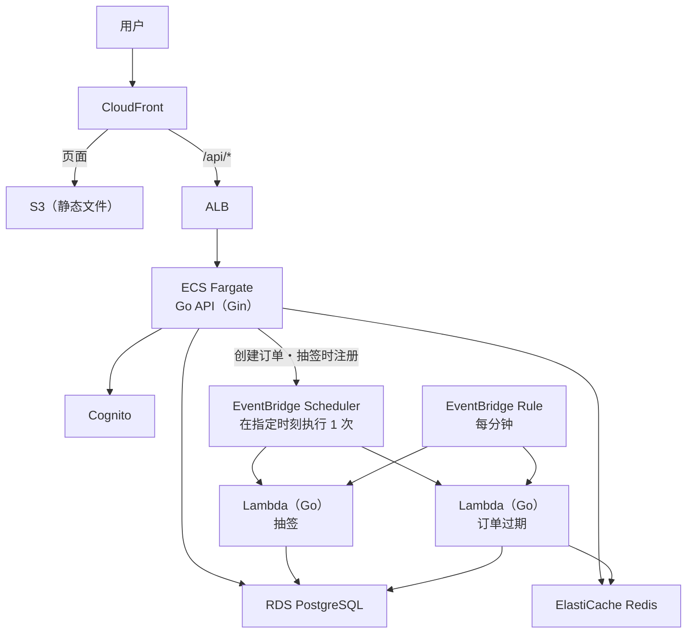

# FlashBuy

[日本語](README.md) | 中文

一个用「抽签」和「先到先得」两种方式销售限量商品的电商网站。后端用 Go（Gin、sqlx、go-redis），页面用 React，运行在 AWS 上。

重点做了三件事：

- **请求集中时也不会卖超**（Redis 和 DB 三道检查，见 [3](#3-防超卖)）
- **Go 的 API 连失败的情况都考虑进去**（事务、回滚补偿、超时、停机流程、幂等，见 [4](#4-go-的实现)）
- **一个人也能运维**（Terraform、GitHub Actions、自动回滚、监控，见 [7](#7-基础设施)）

| | |
|---|---|
| 演示 | <https://d3vk1w3oavfogf.cloudfront.net>（登录页的按钮可以直接以普通用户 / 管理员身份登录） |
| 期间 | 2026年8月〜10月（约 11 周），个人开发 |
| 支付 | 模拟实现，服务端有 40% 的概率返回失败 |

> 为了省钱，不用的时候会停掉 API 等资源（见 [7.4](#74-成本)）。页面能打开但没有数据，就是停机中。

---

## 目录

1. [架构](#1-架构)
2. [主要流程](#2-主要流程)
3. [防超卖](#3-防超卖)
4. [Go 的实现](#4-go-的实现)
5. [测试](#5-测试)
6. [压力测试](#6-压力测试)
7. [基础设施](#7-基础设施)
8. [CI/CD](#8-cicd)
9. [排障案例](#9-排障案例)
10. [已知问题](#10-已知问题)
11. [本地运行](#11-本地运行)

---

## 1. 架构



| 分类 | 技术 |
|---|---|
| 后端 | Go 1.26 / Gin / sqlx / go-redis / zap / viper |
| DB・缓存 | PostgreSQL 15、Redis 7.1 |
| 前端 | React 19 / TypeScript / Vite / Tailwind CSS |
| 认证 | Cognito（JWT 在 API 侧校验） |
| 运行环境 | ECS Fargate（ARM64）、Lambda（Go、ARM64） |
| 异步处理 | EventBridge Scheduler / Rule |
| IaC / CI/CD | Terraform、GitHub Actions（OIDC） |
| 监控 | CloudWatch、SNS |

### 目录结构

```text
api/
  cmd/server/     启动和停机流程
  config/         读取配置（YAML + 环境变量）
  router/         路由
  middleware/     JWT 校验、权限检查
  controllers/    各 API 的处理
  models/         和表对应的结构体
  pkg/            DB、Redis、Cognito、Scheduler、S3、日志、响应等公共处理
lambdas/
  order_expirer/  订单过期
  lottery_drawer/ 抽签（选中签者的逻辑单独放在 draw/ 里）
terraform/        基础设施（9 个目录）
frontend/         页面
```

### 主要 API

| 方法 | 路径 | 认证 | 内容 |
|---|---|---|---|
| GET | `/api/v1/flash/list`、`/api/v1/lottery/list` | 不需要 | 商品列表 |
| POST | `/api/v1/flash/buy` | 需要 | 先到先得购买 |
| POST | `/api/v1/lottery/apply` | 需要 | 报名抽签 |
| POST | `/api/v1/payment/mock` | 需要 | 支付（模拟） |
| GET | `/api/v1/my/flashOrderList` 等 | 需要 | 我的订单 |
| POST | `/api/v1/admin/flash`、`/api/v1/admin/lottery` | 管理员 | 创建商品・抽签 |
| POST | `/api/v1/admin/cache/flush` | 管理员 | 清掉 Redis 缓存，从 DB 重建 |

---

## 2. 主要流程

### 先到先得

1. 检查 JWT 和销售时间
2. 在 Redis 里把库存减 1。没有库存就返回「已售罄」
3. 在事务里创建订单（未支付，支付期限为 15 分钟后），DB 的库存也减 1
4. 在支付期限的时刻，注册一个 Scheduler 的一次性调度
5. 返回订单号

### 抽签

1. 用户报名（每人 1 次，靠唯一约束保证）
2. 管理员创建抽签时，注册抽签时刻的调度
3. 到抽签时刻，Lambda 从报名者中选出中签者
4. 中签者在 72 小时内支付。过期的订单会被取消

### 两种调用方式

Lambda 有两种被调用的方式。

| | Scheduler | EventBridge Rule |
|---|---|---|
| 时机 | 注册的时刻执行 1 次 | 每分钟 |
| 对象 | 1 个订单・抽签 | 所有过期还没处理的 |
| 作用 | 准时处理 | 兜底，捡漏 |

即使 Scheduler 注册失败，每分钟的扫描也会处理。同一个对象被两边都处理，结果也不会变（见 [4.4](#44-幂等与行锁)）。

---

## 3. 防超卖

如果所有购买请求都去更新 DB 的同一行，行锁的等待会变长。所以先在 Redis 里判断库存，DB 作为最终的记录。

库存在 3 个地方检查。

1. **Redis**：用 Lua 脚本把「检查库存」和「减 1」放在一起执行。Redis 执行脚本时不处理别的命令，所以并发请求也不会减到比库存更多
2. **DB**：执行 `UPDATE ... SET stock = stock - 1 WHERE stock > 0`，更新行数为 0 就回滚
3. **CHECK 约束**：表上加了 `CHECK (0 <= stock <= total_stock)`

```lua
local stock = redis.call('GET', KEYS[1])
if not stock then return -2 end            -- 还没加载
if tonumber(stock) <= 0 then return -1 end  -- 已售罄
return redis.call('DECR', KEYS[1])
```

Go 这边把返回值 `-1` / `-2` 转成 `ErrOutOfStock` / `ErrNotPreheated` 两个 error 返回。遇到 `ErrNotPreheated` 时，先用 `SETNX` 把 DB 的库存写进去，再减一次。因为是 `SETNX`，即使同时有多个请求在加载，也不会覆盖已经减掉的数。

同一用户重复购买同一商品，用部分唯一索引（未支付・已支付订单的 `user_id, flash_id`）防止。

Redis 的库存没有设过期时间（TTL）。因为它不是缓存，而是当作销售中的准确数量来管理。Redis 不可用时，商品展示改从 DB 读，但购买会返回错误。

---

## 4. Go 的实现

### 4.1 错误与响应

API 全部返回同一种格式的 JSON。

```json
{ "code": 10001, "message": "商品はすでに売り切れです" }
```

| code | 含义 |
|---|---|
| 0 | 成功 |
| 400 / 401 / 403 | 参数错误 / 认证失败 / 没有权限 |
| 500 | 系统错误 |
| 10001 | 已售罄 |
| 10002 | 已报名抽签 |
| 10003 | 已过支付期限 |
| 10004 | 已购买 |

- 业务错误也用 HTTP 200 返回，靠 `code` 判断。因为 CloudFront 配置了把 403 / 404 换成 `index.html`，API 一旦返回 404，就会拿到 HTML，前端解析 JSON 就会出错。相应地，监控日志里的错误数量（见 [7.3](#73-监控)）
- 错误判断用 `errors.Is` / `errors.As`。比如 `sql.ErrNoRows` 转成参数错误，PostgreSQL 的唯一约束冲突（`23505`）转成「已购买」
- Lambda 里用 `fmt.Errorf("...: %w", err)` 附上信息再返回，调用方能追到原因

### 4.2 事务与失败时的回滚补偿

购买时，先在 Redis 里减库存，再开 DB 事务。Redis 和 DB 放不进同一个事务，所以**DB 这边不管在哪一步失败，都把 Redis 的库存加回 1**。

| 失败的位置 | 处理 |
|---|---|
| 开启事务 | 恢复 Redis，返回系统错误 |
| 插入订单（重复购买） | 回滚，恢复 Redis，返回「已购买」 |
| 更新库存（更新行数为 0） | 回滚，恢复 Redis，返回「已售罄」 |
| 提交 | 恢复 Redis，返回系统错误 |
| 注册调度 | 订单已经成立，只记日志（由每分钟的扫描兜底） |

Lambda 的取消处理在 `BeginTxx(ctx, nil)` 之后紧接着写 `defer tx.Rollback()`。中途 `return` 也会回滚，提交之后则什么都不做。Redis 的库存在提交之后再恢复。即使失败，只要删掉这个 key，下次访问时就会从 DB 的值重建。

### 4.3 超时与停机流程

- **Redis**：所有操作都加了 `context.WithTimeout`（2 秒）。Redis 不响应时，请求也不会卡住
- **HTTP 服务器**：设置了 `ReadHeaderTimeout`・`ReadTimeout`・`WriteTimeout`・`IdleTimeout`。不设就是无限制，什么都不发的连接会一直占着 socket。数值比 ALB 的空闲超时（60 秒）短，先由服务器断开
- **停机流程**：服务器在 goroutine 里启动，用 channel 等 `SIGTERM`。收到后调用 `srv.Shutdown`，最多等 5 秒让处理中的请求结束再停。这样 ECS 替换任务时，请求不会被中途切断
- **外部 API**：Lambda 调用 SNS 时设了 3 秒超时（见 [9.2](#92-lambda-发送-sns-花了-51-秒)）

### 4.4 幂等与行锁

Lambda 可能对同一个对象被调用 2 次，所以做成执行几次结果都一样。

- **取消**：用 `UPDATE ... WHERE status = 'UNPAID' AND expires_at < now() RETURNING ...`，只返回真正取消掉的行。第 2 次没有对象，库存也不会被加回两次
- **每分钟扫描**：用 `FOR UPDATE SKIP LOCKED`，不会和单个取消在同一行上互相等待
- **抽签**：先用 `FOR UPDATE` 锁住抽签的行，再只更新 `status = 'WAITING'` 的报名。同时跑 2 次，第 2 次什么都不做
- **报名**：用 `INSERT ... ON CONFLICT (user_id, lottery_id) DO NOTHING`，一条 SQL 挡住重复报名
- **支付**：用 `UPDATE ... WHERE status = 'UNPAID' AND expires_at >= now()`，即使过期处理还没跑，过了期限的订单也付不了

### 4.5 缓存

列表和详情用泛型写的 `cache.Remember[T]`：缓存里没有就从 DB 读，再写回缓存（Cache Aside）。

```go
flashList, err := cache.Remember(cache.KeyFlashList, cache.TTLList,
    func() ([]models.FlashItem, error) { /* 从 DB 取 */ })
```

- 列表的 TTL 是 30 秒。详情用 `RememberUntil`，把 TTL 设到销售结束的时刻
- Redis 不可用时不报错，改从 DB 读。缓存只是为了加速，挂了也能正常展示
- 管理员的角色不在 JWT 里，从 DB 读，并缓存 5 分钟
- Redis 和 DB 的库存对不上时，用管理员 API 删掉应用的 key 重建。`KEYS` 会让 Redis 卡住，所以用 `SCAN` 分批删

### 4.6 连接与 goroutine

- **连接池**：API 的 DB 连接最多 50（理由见 [6](#6-压力测试)）
- **Lambda**：用 `sync.Once` 只建一次连接，后续调用复用。每个 Lambda 只用 1 个连接（`SetMaxOpenConns(1)`）
- **goroutine 的取舍**：过期处理在本地环境是 API 里的 goroutine 每分钟跑一次。ECS 加任务时 goroutine 也会变多、导致重复处理，所以 AWS 上交给 Lambda

### 4.7 认证

- 在 API 的中间件里用公钥校验 Cognito 的 JWT。检查签名（只允许 RS256）、`iss`、`exp`、`aud`、`token_use`
- 公钥（JWKS）启动时获取，每小时刷新一次。遇到不认识的 key ID 也会重新获取
- 管理员 API 是在 `AuthRequired()` 之后再接 `RequireRole("admin")` 来保护

### 4.8 配置与日志

- 配置用 viper，读取 `config-{环境}.yaml`，再用 `FLASHBUY_` 开头的环境变量覆盖。生产的值不放进镜像，从 ECS 的任务定义用环境变量传入
- 日志用 zap。生产环境输出 JSON，在 CloudWatch 里可以直接检索和统计

### 4.9 抽签算法

中签者用 Fisher-Yates 洗牌选出。随机数用 `crypto/rand`，保证无法预测。这部分拆成了不依赖 DB 和 AWS 的函数（`draw.PickWinners`），可以单独测试。

---

## 5. 测试

| 对象 | 数量 | 内容 |
|---|---|---|
| 购买 API | 3 | 无库存、重复购买、DB 库存不足时恢复 Redis |
| 订单过期 | 13 | 取消 SQL 的条件、Redis 库存的恢复、过期的整体流程 等 |
| 抽签 | 4 | 中签人数、没有重复和遗漏、不修改输入、分布是否均匀 |

购买 API 的测试把 DB 换成 `sqlmock`、Redis 换成 `miniredis`，不用容器就能跑。所有测试在每次 PR 时都会在 GitHub Actions 上执行。

---

## 6. 压力测试

用 k6 按固定速率向运行中环境的购买 API 发请求。

- 配置：ECS 任务 1 个（0.25 vCPU / 512 MB）、RDS db.t4g.micro、Redis 1 个节点
- 每次 15〜30 秒，库存 100,000

| 目标 | 实际处理量 | p95 | 结果 |
|---|---|---|---|
| 50 req/s | 49.9 req/s | 49 ms | 无错误 |
| 120 req/s | 118.5 req/s | 56 ms | 无错误 |
| 150 req/s | 138.9 req/s | 1.17 s | 能处理但变慢 |
| 200 req/s | 84.7 req/s | 5.45 s | 处理不过来，473 个请求没发出去 |

每秒 120 个请求以内是稳定的。RDS 的 CPU 不到 10%，瓶颈是 ECS 的 CPU（0.25 vCPU）。200 req/s 时也没有出现 5xx。

**连接池**：一开始连接池上限设的是 100，150 req/s 时出了 239 个 500 错误。RDS 的 `max_connections` 是 79，去掉预留后只有约 65 个能用。把上限降到 50 后，错误变成 0，处理量也从 112.3 提高到 138.9 req/s。剩下的连接留给 Lambda。

**超卖**：库存 200，15 秒内发了 1,501 个请求，订单是 200 个，剩下 1,301 个都是「已售罄」（`10001`）。

这些数字只针对这个配置。改了任务数或实例规格，需要重新测。

---

## 7. 基础设施

区域是 `ap-northeast-1`。选 ECS Fargate 是因为不用管服务器，常驻进程可以复用 DB 和 Redis 的连接。过期处理和抽签是在固定时刻、几秒就结束的处理，所以用 Lambda。

### 7.1 网络

- VPC 跨 2 个 AZ，公有子网和私有子网各 2 个
- ALB 在公有子网，只允许来自 CloudFront（托管前缀列表）的流量
- ECS 放在公有子网并分配公网 IP。因为没有 NAT，要调用 Scheduler 和 Cognito 的 API 只能这样。只接受来自 ALB 的流量
- RDS、Redis、Lambda 在私有子网
- 出于成本原因，没有 NAT Gateway 和 VPC 端点（影响见 [10](#10-已知问题)）

### 7.2 权限

- DB 密码放在 Secrets Manager，ECS 任务启动时作为环境变量传入
- GitHub Actions 用 OIDC 获取临时凭证。IAM 角色按用途分成 5 个，API 部署用的角色只能 push 到 ECR 和更新 ECS

### 7.3 监控

- CloudWatch 告警共 14 个（ALB、ECS、RDS、Redis、Lambda、应用的错误日志）。通知通过 SNS 发邮件
- 业务错误用 HTTP 200 返回，ALB 的 5xx 抓不到。所以把日志里的 `level=error` 做成指标，5 分钟内 5 次以上就告警
- RDS 连接数到 60 就告警。实际能用的大约是 65，要在那之前发现

### 7.4 成本

全部运行每月约 76 美元。用 `scripts/spindown.sh` 删掉 ALB、ECS、RDS、Redis、Lambda 等之后，每月约 1 美元。`scripts/spinup.sh` 按依赖顺序重建，导入 DB 初始数据，一直确认到 API 能正常响应。

Cognito 不删。重建后用户 ID（`sub`）会变，和初始数据对不上。

### 7.5 Terraform

`terraform/` 分成 9 个目录，state 也各自独立（S3，用 `use_lockfile` 加锁）。经常改的 `compute`・`lambda` 和基本不动的 `data` 等分开，缩小一次 apply 影响的范围。

apply 在本地手动执行。PR 里会自动跑格式检查和 plan，差异在那里确认。

---

## 8. CI/CD

| workflow | 内容 |
|---|---|
| `api-ci` / `lambda-ci` | push 到 `develop`・`main` 和 PR 时，构建并测试 |
| `api-cd` | 打 `v*` 标签时构建 ARM64 镜像，push 到 ECR，ECS 滚动更新 |
| `lambda-cd` | 打 `v*` 标签时更新代码，发布新版本，切换别名 `live` |
| `frontend` | `develop` 发到开发环境，`main` 发到生产（需要审批） |
| `terraform` | PR 时做格式检查和 plan |
| `ci-notify` | CI 失败时自动创建 GitHub Issue |

- Docker 镜像用多阶段构建。用 `CGO_ENABLED=0` 交叉编译成 ARM64，只把 Go 的二进制放进 Alpine
- 标签只能打在 `main` 包含的提交上
- ECS 开了部署熔断器，启动失败会自动回到上一个版本。回滚后服务也会进入稳定状态，所以最后会确认实际在跑的任务定义，判断成功还是失败
- 手动回滚时，ECS 指向上一个任务定义，Lambda 把别名指向上一个版本。都只需要一条命令

---

## 9. 排障案例

### 9.1 过期订单没有马上被取消

- **现象**：过了期限库存也没回来，有时要等到每分钟的扫描
- **原因**：写入 DB 的期限和注册调度的时刻，各自调用了 `time.Now()`。调度早了几毫秒执行，被判断成「还没到期」
- **处理**：期限只算一次，DB 和调度用同一个值

### 9.2 Lambda 发送 SNS 花了 51 秒

- **现象**：抽签后发送 SNS 迟迟不结束
- **原因**：没有 NAT 也没有 VPC 端点，私有子网里的 Lambda 连不到 SNS，SDK 一直在重试
- **处理**：外部调用都加上 `context.WithTimeout`（SNS 为 3 秒）。DB 密码也取不到 Secrets Manager，所以 Lambda 改用环境变量传入

### 9.3 抽签的调度没注册上，却没有报错

- **现象**：创建抽签成功了，但 Scheduler 里没有调度
- **原因**：IAM 策略的资源写成了 schedule group 的 ARN，正确的是它下面的 `schedule/<group>/*`。API 注册失败时只打日志，照样返回成功
- **处理**：改正 ARN。为了注册失败时也不漏处理，保留了每分钟的扫描

---

## 10. 已知问题

| 问题 | 内容 | 对策 |
|---|---|---|
| DB 的 context | API 的 DB 操作没有接收 `context`，请求断了 SQL 也会执行到最后 | 改成 `QueryRowContext` 等，传入请求的 `context` |
| 抽签结果通知 | Lambda 连不到 SNS，发不了中签通知。这个失败不会变成 Lambda 的错误，所以告警也不会响 | 加 SNS 的 VPC 端点（每月约 14 美元） |
| 密码的传法 | Lambda 的 DB 密码是用环境变量传的 | 加 Secrets Manager 的端点后改回来 |
| 可用性 | ECS 1 个任务、RDS 单 AZ、Redis 1 个节点。`/ping` 只看进程是否存活 | 任务改成 2 个，加上同时检查 DB 和 Redis 的健康检查 |
| 环境 | 生产的页面用的也是开发环境的 API | 分出生产用的后端 |
| 抽签递补 | 中签者没付款的名额，不会顺延给下一个人 | 抽签时记录顺位，取消时顺延给下一个人 |

---

## 11. 本地运行

```bash
cd api && docker compose up -d                 # PostgreSQL 15 + Redis 7
PGPASSWORD=postgres psql -h localhost -U postgres -d flashbuy -f init_db.sql
APP_ENV=local go run ./cmd/server              # API :8080
go test ./...                                  # 测试
cd ../frontend && pnpm install && pnpm dev     # 页面 :5173
```

不指定 `APP_ENV` 会使用云上的配置（`dev`），本地要加上 `APP_ENV=local`。认证用的是 Cognito，所以需要 AWS 的认证信息。

---

## 关于开发

代码的实现用了生成式 AI（Claude Code）。设计、AWS 的构建、代码审查、动作确认、故障的调查和处理都是自己做的。

## License

[MIT License](LICENSE)
