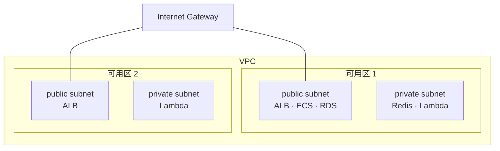
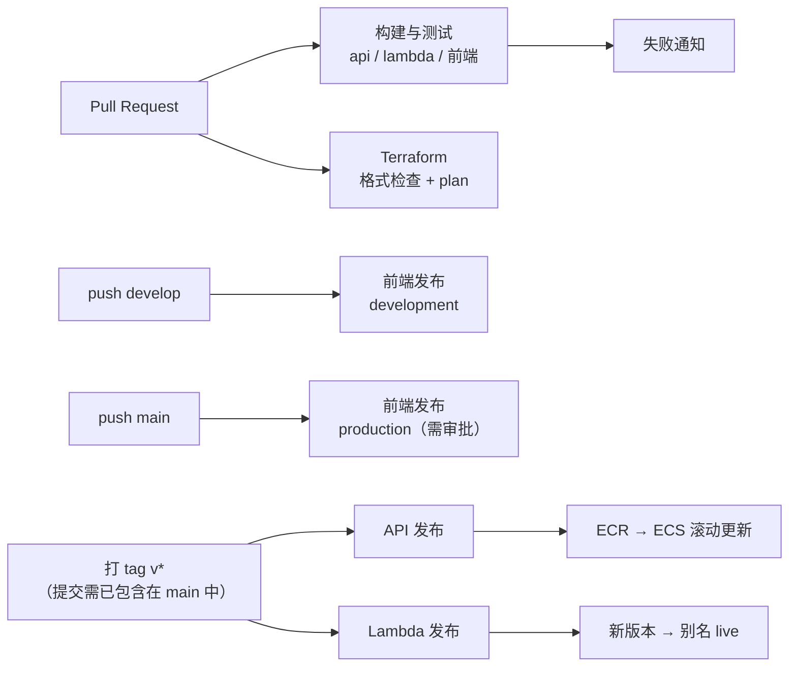
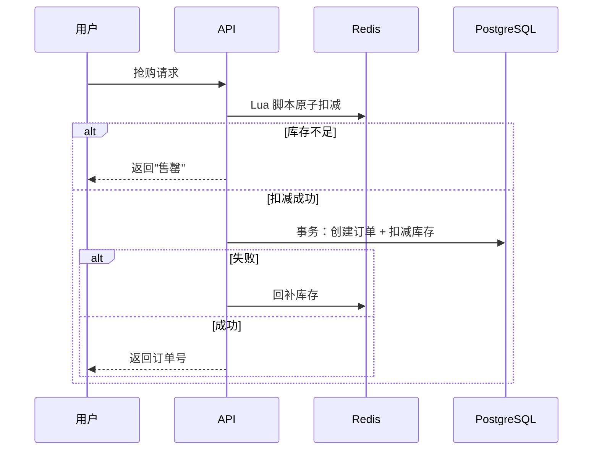

# FlashBuy

[日本語](README.md) | 中文

FlashBuy 是一个提供限量抢购与公平抽签两种服务的电商系统。使用 Go（Gin）+ PostgreSQL / React 实现，并部署在 AWS 上。基础设施和 CI/CD 分别由 Terraform 与 GitHub Actions 负责。支付为模拟实现，成功或失败由服务端按概率返回。

在线演示：<https://d3vk1w3oavfogf.cloudfront.net>

登录页有一键演示登录按钮，可分别以普通用户和管理员身份进入。用管理员登录可以走通创建抽签的完整流程。

---

## 目录

1. [架构与流程](#1-架构与流程)
2. [AWS 基础设施](#2-aws-基础设施)
3. [IaC 与 CI/CD](#3-iac-与-cicd)
4. [防超卖与公平开奖](#4-防超卖与公平开奖)
5. [排查记录](#5-排查记录)
6. [其他](#6-其他)
7. [License](#7-license)

---

## 1. 架构与流程

### 1.1 整体架构

```mermaid
flowchart TB
  U["用户"] --> CF["CloudFront"]
  CF -->|前端| S3F["S3<br/>静态文件"]
  CF -->|"/api/*"| ALB["ALB"]
  ALB --> ECS["ECS Fargate<br/>Go API"]
  ECS -->|"订单 · 商品 · 用户"| RDS["RDS PostgreSQL"]
  ECS -->|"库存 · 缓存"| RD["ElastiCache Redis"]
  ECS -->|"注册 · 登录"| COG["Cognito"]
  ECS -.->|"签发上传地址"| S3I["S3<br/>商品图片"]
  ECS -->|"下单 / 创建抽签时注册"| SCH["EventBridge Scheduler<br/>在指定时刻执行一次"]
  SCH -->|到时调用| L1["Lambda 抽签开奖"]
  SCH -->|到时调用| L2["Lambda 订单到期处理"]
  RULE["EventBridge Rule<br/>每分钟"] -->|扫描| L1
  RULE -->|扫描| L2
  L1 --> RDS
  L1 -.->|"开奖通知（未送达）"| SNS["SNS"]
  L2 --> RDS
  L2 --> RD
```



### 1.2 业务流程

**限量抢购**

```
1. 校验 Cognito JWT 与销售时间窗，非售卖期直接拒绝
2. Redis Lua 原子扣减库存；库存不足则返回"已售罄"
3. 事务写入订单（UNPAID，到期时间 = 当前时间 + 15 分钟）并扣减数据库库存
4. 向 Scheduler 注册到期时刻的一次性调度
5. 返回订单号
```

下单为同步流程：库存扣减依赖 Redis 单线程的原子性，用户也需要立即得到结果。订单到期取消与库存回补是独立的批处理，由 Lambda 承担。

**抽签**

```
1. 管理员创建抽签时，API 向 Scheduler 注册开奖时刻的一次性调度
2. 开奖时刻，Lambda 读取报名列表，随机抽出中奖者
3. 中奖者状态为 UNPAID，须在 72 小时内付款；其余为 LOST
4. 超期未付款的订单由订单到期处理 Lambda 取消
```

### 1.3 技术栈

| 类别 | 选型 |
|---|---|
| 前端 | React 19 / TypeScript / Vite / Tailwind CSS |
| 后端 | Go 1.26 / Gin / sqlx / zap / viper |
| 数据库与缓存 | PostgreSQL 15（RDS）、Redis 7.1（ElastiCache） |
| 认证 | Amazon Cognito |
| 计算 | ECS Fargate（ARM64）、Lambda（Go，ARM64） |
| 调度 | EventBridge Scheduler / Rule |
| 静态托管 | S3 + CloudFront |
| IaC / CI/CD | Terraform、GitHub Actions（OIDC） |
| 监控 | CloudWatch、SNS |

---

## 2. AWS 基础设施

区域：`ap-northeast-1`。

### 2.1 网络

VPC 跨 2 个可用区，public subnet 与 private subnet 各 2 个。



- ALB 的安全组只放行 CloudFront 的托管前缀列表；ECS 只接受来自 ALB 的流量；RDS 与 Redis 接受来自 VPC 网段的连接，并另加管理员 IP 白名单。
- **无 NAT Gateway、无 VPC Endpoint**，以控制固定成本（NAT Gateway 在东京区域约 $45/月）。对应的设计：
  - Lambda 位于 private subnet，只访问 VPC 内的 RDS 与 Redis，DB 密码通过环境变量传入
  - ECS 需要调用 Scheduler、Cognito、S3 等 AWS API，因此置于 public subnet 并分配公网 IP
  - RDS 开启公网访问，由安全组白名单限定来源，便于本地直连调试

### 2.2 入口与计算

- **CloudFront**：默认路径指向 S3，`/api/*` 指向 ALB，API 路径关闭缓存；前端 S3 桶为私有，仅允许 CloudFront 读取。
- **ECS Fargate**：ARM64，0.25 vCPU / 512 MB，常驻 1 个任务，应用为无状态设计。
- **滚动更新**：最小健康比例 100%、最大 200%，新旧任务并存，服务不中断；开启 deployment circuit breaker，新任务启动失败时自动回滚。
- **ECR**：保留最近 5 个镜像 tag。
- **Secrets Manager**：存放 DB 密码，容器启动时以环境变量注入。

### 2.3 数据与认证

- **RDS PostgreSQL 15**：`db.t4g.micro`，单 AZ，存储加密。负载可预测且目前很低，因此选择 RDS。Aurora Serverless v2 可以缩容到 0 ACU，但系统每分钟扫描一次数据库，全天都有连接，不满足自动暂停的条件。
- **ElastiCache Redis 7.1**：单节点，位于 private subnet，承担库存实时判定与缓存。
- **S3**：商品图片由浏览器通过签名 URL 直传，API 只负责签发上传地址。
- **Cognito**：邮箱 + 密码登录，token 有效期 access / id 24 小时、refresh 30 天。API 使用 Cognito 公钥在本地验证 JWT 签名；用户角色保存在 `users` 表，Redis 缓存 5 分钟。

### 2.4 异步任务：Lambda 与 EventBridge

两个 Lambda 函数：**订单到期处理**（取消超过支付期限仍未付款的订单）与**抽签开奖**。两类任务触发时机明确、无需实时响应、单次运行数秒即可完成，适合按调用计费的 Lambda。

每个函数有两条独立、同时存在的触发路径：

| | 路径 1：按对象精确触发 | 路径 2：每分钟扫描 |
|---|---|---|
| 触发者 | API 在业务事件发生时向 Scheduler 注册一次性调度，到时由 Scheduler 调用 Lambda | EventBridge Rule 每分钟调用 Lambda |
| 订单到期处理 | 下单成功时注册"当前时间 + 15 分钟"的调度，到期仍未付款则取消并回补库存 | 扫描超期未付款的订单（抢购订单与抽签订单） |
| 抽签开奖 | 创建抽签时注册开奖时刻的调度，到时开奖 | 扫描开奖时间已过、仍有"报名中"记录的抽签 |

- 两条路径调用同一个函数，以事件中的 `mode`（`cancel` / `draw` / `scan`）分流，`scan` 表示来自每分钟扫描的调用。路径 1 使处理及时，路径 2 回收路径 1 遗漏的任务（例如调度注册失败）。
- 一次性调度需要在运行时按订单、按抽签创建，由具备出网能力的 API 调用 Scheduler；周期扫描是固定的批处理，由 Terraform 静态定义为 Rule，Lambda 无需出网。

### 2.5 监控与告警

CloudWatch 已覆盖指标、日志、告警与看板，并与各服务直接集成，因此选用 CloudWatch 原生方案。

**Dashboard 的 8 个组件**

| # | 类型 | 内容 |
|---|---|---|
| 1 | text | 标题 |
| 2 | metric | ALB 请求数与 5xx |
| 3 | metric | ALB 响应时间与异常 target |
| 4 | metric | ECS 任务 CPU / 内存 |
| 5 | metric | RDS CPU / 连接数 |
| 6 | metric | Lambda 调用次数与错误 |
| 7 | metric | ElastiCache CPU 与 Evictions |
| 8 | alarm | 12 条告警的状态 |

**12 条告警**（发送到 SNS 邮件订阅）

| # | 名称 | 指标 | 阈值 | 周期 × 次数 |
|---|---|---|---|---|
| 1 | `alb-unhealthy` | UnHealthyHostCount | ≥ 1 | 60s × 2 |
| 2 | `alb-5xx` | HTTPCode_Target_5XX_Count | ≥ 5（5 分钟合计） | 300s × 1 |
| 3 | `alb-latency` | TargetResponseTime | > 2 秒（5 分钟平均） | 300s × 1 |
| 4 | `ecs-cpu` | CPUUtilization | > 80% | 300s × 2 |
| 5 | `ecs-memory` | MemoryUtilization | > 80% | 300s × 2 |
| 6 | `rds-cpu` | CPUUtilization | > 80% | 300s × 2 |
| 7 | `rds-storage` | FreeStorageSpace | < 2 GB | 300s × 1 |
| 8 | `rds-connections` | DatabaseConnections | > 60 | 300s × 2 |
| 9 | `redis-cpu` | CPUUtilization | > 80% | 300s × 2 |
| 10 | `lottery-drawer-errors` | Errors | ≥ 1 | 300s × 1 |
| 11 | `lottery-drawer-throttles` | Throttles | ≥ 1 | 300s × 1 |
| 12 | `order-expirer-errors` | Errors | ≥ 1 | 300s × 1 |

库存数据保存在 Redis，因此 Evictions（数据被淘汰）也在 Dashboard 中展示。

### 2.6 成本控制

项目提供两个脚本按需创建与销毁云环境：

- `scripts/spinup.sh`：按依赖顺序创建全部资源，并确认 ALB 健康检查通过、经 CloudFront 调用 API 能返回数据。
- `scripts/spindown.sh`：逆序销毁计费资源，月费由约 $76 降到约 $1。`frontend` / `auth` / `state` / `shared` / `storage` 默认保留，其中 `auth` 必须保留：Cognito 重建后 `sub` 会变化，`init_db.sql` 里的种子用户就对不上了。

停机期间前端可访问、API 不可用（ALB 随 `compute` 销毁），执行 `spinup.sh` 后恢复。

### 2.7 选型与取舍

| 议题 | 选择 | 替代方案 | 理由 |
|---|---|---|---|
| API 运行形态 | ECS Fargate | EC2 自建集群；整个 API 部署在 Lambda 上 | 省去节点运维；常驻进程可复用 Redis 连接池，部署在 Lambda 上则需处理连接复用与冷启动 |
| 库存判定 | Redis 负责实时判定，PostgreSQL 负责持久记录 | 只用数据库行锁 | 并发请求集中时，行锁会使请求排队并放大等待 |
| 延迟任务 | Scheduler 的一次性调度 | 应用内定时器 | 精度到秒，执行后自动删除；应用内定时器在多实例下会重复执行 |
| 认证 | Cognito | 自行签发 JWT | 密码散列、令牌签发、公钥轮换无需自己实现 |
| CI/CD | GitHub Actions + OIDC | CodePipeline | 代码已在 GitHub；OIDC 免长期密钥 |

---

## 3. IaC 与 CI/CD

### 3.1 Terraform

拆分为 9 个模块，各自独立的 state。`lambda` / `compute` / `frontend` 通过 `terraform_remote_state` 读取上游输出，`monitoring` 按资源名称查询。

| 模块 | 内容 |
|---|---|
| `state` / `shared` | State 用的 S3 桶；GitHub OIDC Provider 与 CI 用的 plan 角色 |
| `data` | VPC、子网、RDS、ElastiCache、安全组 |
| `auth` / `storage` | Cognito；商品图片 S3 桶 |
| `lambda` | Lambda、EventBridge、Scheduler 角色、SNS |
| `compute` | ALB、ECS、ECR、Secrets Manager |
| `frontend` | S3 + CloudFront（dev / prod） |
| `monitoring` | Dashboard 与告警 |

执行顺序：`state` → `shared` → `data` → `auth` → `storage` → `lambda` → `compute` → `frontend` → `monitoring`。

**拆分依据是变更频率和数据生命周期**：`data` 创建耗时 8–10 分钟，是主要成本项，但不常改动；`compute` / `lambda` 随版本发布变化；`auth` / `storage` 保存用户和图片，生命周期独立。这样只需要 apply 改动的那一层，环境也能分层销毁重建。代价是跨模块改动要按顺序 apply 多次。

### 3.2 CI/CD 流水线

AWS 认证全部使用 GitHub OIDC 获取的临时凭证。共 7 条 workflow：



| workflow | 触发 | 内容 |
|---|---|---|
| API CI / Lambda CI | push / PR | build / vet / test；Lambda 的 `build.sh` 先执行 `go test`，再产出 zip |
| API CD / Lambda CD | push tag `v*` | 一个 tag 同时触发 API 与 Lambda 的发布，API 镜像标签即 tag 名 |
| Frontend | push / PR | lint / build，发布到 S3 并刷新 CloudFront |
| Terraform CI | 仅 PR | 格式检查，8 个模块并行 plan（`state` 仅用于首次 bootstrap，不在其中；`apply` 由人工在本地执行） |
| CI Notify | 其他 workflow 完成后 | 失败时创建 Issue，恢复后自动关闭；Slack 通知按需开启 |

### 3.3 发布与回滚

- **API 发布**：构建 arm64 镜像推送 ECR → 取出线上任务定义，仅替换镜像并注册新 revision → 更新 ECS 服务并等待稳定 → 比对线上实际运行的 revision 与新注册的 revision。部署失败触发自动回滚后，服务同样会进入 stable 状态，因此用比对结果区分"部署成功"与"失败后回滚完成"。
- **Lambda 发布**：更新代码并等待完成 → 发布新版本 → 切换 `live` 别名。触发器都指向别名。
- **回滚**：Lambda 用 `update-alias` 指回旧版本，API 用 `update-service` 指定旧的 task definition revision，各只需一条命令。Lambda 即时生效，API 需等待 ECS 滚动更新完成。
- **约定**：检查类任务可以被打断，发布类任务不可被打断；Terraform 管理资源结构，CI 管理版本（`ignore_changes`）；tag 指向的提交必须已包含在 main 中，强制 develop → main → tag 的流程。

### 3.4 权限设计

- GitHub Actions 使用 5 个 IAM 角色（terraform-plan、api-dev、lambda-dev、frontend-dev、frontend-prod），按用途拆分，权限按资源范围收窄。例如 API 发布角色只包含 ECR 推送与 ECS 更新等发布所需权限，基础设施变更由人工执行。
- GitHub Environments 放行规则：`development` 放行 `develop` 分支与 `v*` 标签，`production` 仅放行 `main`，并要求人工审批。
- Terraform plan 的 job 限定只对同源 PR 执行：plan 角色可读取 state 桶（其中含数据库密码），而公开仓库中来自 fork 的 PR 会使用 PR 一侧提交的 workflow 定义，存在借 workflow 窃取凭证的风险。

---

## 4. 防超卖与公平开奖

### 4.1 防超卖

抢购的瞬时并发高，如果所有请求都对数据库同一行执行 `stock = stock - 1`，会在行锁上排队。因此库存的实时判定放在 Redis，数据库作为最终记录。



1. **Redis 原子扣减**：Lua 脚本把"读取库存、判断是否充足、扣减"放在一次调用里，Redis 执行期间不处理其他命令
2. **数据库条件更新**：事务内执行 `UPDATE ... WHERE stock > 0`，表上还有 `CHECK (0 <= stock <= total_stock)` 约束，作为最后一道保障
3. **失败回补**：数据库事务失败时，回补 Redis 的库存

补充说明：

- 库存 key 无 TTL，库存属于交易数据，过期会使数值与实际脱节；首次访问时从数据库加载，并发时以先写入的为准。
- Redis 不可用时，库存与缓存读取自动降级到数据库。

### 4.2 订单到期的处理

订单到期未处理会导致库存无法回补，商品一直显示售罄。触发路径见 [2.4](#24-异步任务lambda-与-eventbridge)，处理逻辑如下：

- **可重复执行**：取消 SQL 同时带有状态条件（未付款）与期限条件，重复触发或用户恰好在此时付款，都不会改动已支付的订单。
- **取消与回补在同一事务内**：分开提交的话，订单已取消但库存没回来，该订单之后不会再被扫描到，库存将永远得不到回补。

### 4.3 公平开奖

抽签的精确调度与每分钟扫描可能同时处理同一场抽签，开奖需要保证结果只产生一次。事务步骤：

1. 对该抽签记录加行锁（`FOR UPDATE`），并发的另一方等待
2. 读取全部"报名中"的记录；为空说明已开过，直接结束
3. 使用加密级随机数做洗牌（Fisher-Yates），取前 N 名作为中奖者
4. 全部报名先置为"落选"，再将中奖者改为"待付款"并写入 72 小时的支付期限
5. 提交事务后发布 SNS 事件（超时 3 秒，失败不影响开奖结果）

- 行锁用于避免并发开奖互相覆盖：没有行锁时，后到的一方会把先到者已判定的"落选"改回"待付款"，使中奖人数超出名额。
- 重复报名由 `UNIQUE (user_id, lottery_id)` 约束保证，在数据库层面原子判定。

---

## 5. 排查记录

### 5.1 开奖调度注册失败，却没有任何报错

- **现象**：创建抽签的接口返回成功，但 Scheduler 中没有对应的开奖调度。
- **原因**：`CreateSchedule` 的授权对象是 schedule group 下的 `schedule/<group>/*`，IAM 策略里的资源 ARN 写成了 schedule group 本身，调用因此被拒绝；API 对注册失败只记录日志，接口仍返回成功。
- **处理**：修正 ARN，并将每分钟扫描作为必要组件保留，两条触发路径由此并存。外部调用失败时若降级为只记日志，必须同时配置告警。

### 5.2 private subnet 内的 Lambda 调用 AWS API 一直等待

- **现象**：Lambda 里一次 SNS 发布耗时 51 秒，调用长时间没有返回，同类调用会一直等待到函数超时。
- **原因**：VPC 没有 NAT Gateway 与 VPC Endpoint，连接请求没有得到响应，SDK 持续重试。
- **处理**：
  - DB 密码改为环境变量注入（VPC 内的 Lambda 无法访问 Secrets Manager）。
  - 停用开奖函数里的调度注册：不再注入相关环境变量，代码保留，重新注入即可恢复。72 小时支付期限的到期处理由每分钟扫描承担。
  - 所有外部调用设置短超时（SNS 为 3 秒）。

### 5.3 调度比数据库里的期限早几毫秒

- **现象**：订单到期后库存没有立即回补，要等下一分钟的扫描才生效。
- **原因**：写库的到期时间与注册调度的时刻各取了一次当前时间，相差几毫秒。调度早于数据库中的期限触发，被判定为"尚未到期"而放弃取消，一次性调度执行后即被删除。
- **处理**：到期时间只计算一次，写库与注册共用同一个值。

---

## 6. 其他

### 6.1 API 约定

所有响应的 HTTP 状态码均为 200，结果由响应体中的 `code` 表示：`0` 成功；业务错误有 `10001` 库存不足、`10002` 重复报名、`10003` 支付期限已过；参数、认证、权限、系统错误分别为 `400` / `401` / `403` / `500`。

原因：前端为单页应用，CloudFront 将 403 / 404 统一替换为首页，API 若返回 404 会被替换成 HTML。

代价：ALB 的 5xx 告警对这类错误不起作用，需要通过应用日志统计。

### 6.2 测试

订单到期处理有 13 个测试，开奖逻辑有 4 个测试（人数正确性、不重不漏、入参不被修改、随机性），均由 CI 执行。API 与前端暂无测试。

### 6.3 已知限制与待办

| 事项 | 优先级 | 现状与下一步 |
|---|---|---|
| 压测尚未实施 | 高 | 抢购链路的并发上限与超卖验证数据待补，计划压测库存扣减与下单事务 |
| 中奖名额逾期后不递补 | 高 | 中奖者逾期未付只改成 `CANCELLED`，空出的名额未设置递补机制 |
| 抽签只支持 0 报名费 | 高 | 报名不产生支付 |
| HTTPS 与自定义域名 | 中 | 仅 HTTP:80 回源，使用 CloudFront 默认证书。补充 ACM、Route 53 与 ALB 443 监听 |
| 网络与密钥 | 中 | 无 NAT / Endpoint，Lambda 的 DB 密码为环境变量。具备网络条件后统一使用 Secrets Manager |
| 规格与环境 | 中 | ECS 单任务、RDS 单 AZ、Redis 单节点；后端只有一套环境，prod 环境的前端同样指向 dev 的 ALB |
| 可靠性 | 中 | `/ping` 不检查数据库与 Redis，依赖故障时 ALB 不会摘除任务；HTTP server 未设读写超时 |
| 限流与注册验证 | 中 | 登录、下单、报名没有频率限制；注册跳过邮件验证 |
| 业务指标监控 | 中 | 目前只有基础设施指标。计划用 EMF 产出下单成功与售罄次数、报名与中签数等业务指标 |
| 开奖通知 | 低 | 开奖后发布 SNS 事件，但 Lambda 位于无出网的子网，请求无法到达 SNS，主题也暂无订阅者。具备网络条件后接入邮件或推送 |

### 6.4 开发体制

个人开发，周期约 11 周（2026-08 至 2026-10）。负责 AWS 基础设施、Terraform、GitHub Actions、架构设计，以及部署后的功能验证与排错。Go 与前端代码在生成式 AI 的辅助下编写，方案讨论时也用它作为参考。

### 6.5 本地运行

```bash
cd api && docker compose up -d                 # PostgreSQL 15 + Redis 7
PGPASSWORD=postgres psql -h localhost -U postgres -d flashbuy -f init_db.sql
APP_ENV=local go run ./cmd/server              # API :8080
cd ../frontend && pnpm install && pnpm dev     # 前端 :5173
```

`APP_ENV` 默认为 `dev`（读取面向云端 RDS 的配置），本地运行需显式指定 `APP_ENV=local`；`init_db.sql` 含 `TRUNCATE`，连接云端 RDS 时请勿执行；本地运行需要 AWS 凭证，注册 / 登录会访问真实的 Cognito。云环境使用 `scripts/spinup.sh` 创建。

### 6.6 目录结构

```
api/          Go API（ECS Fargate 运行）
frontend/     前端
lambdas/      order_expirer / lottery_drawer
terraform/    9 个模块
scripts/      spinup.sh / spindown.sh / 運用マニュアル.md（操作手册）
.github/      7 条 workflow
data_design.md  数据设计（类型 / 表结构 / 缓存 / 查询）
```

## 7. License

[MIT License](LICENSE)